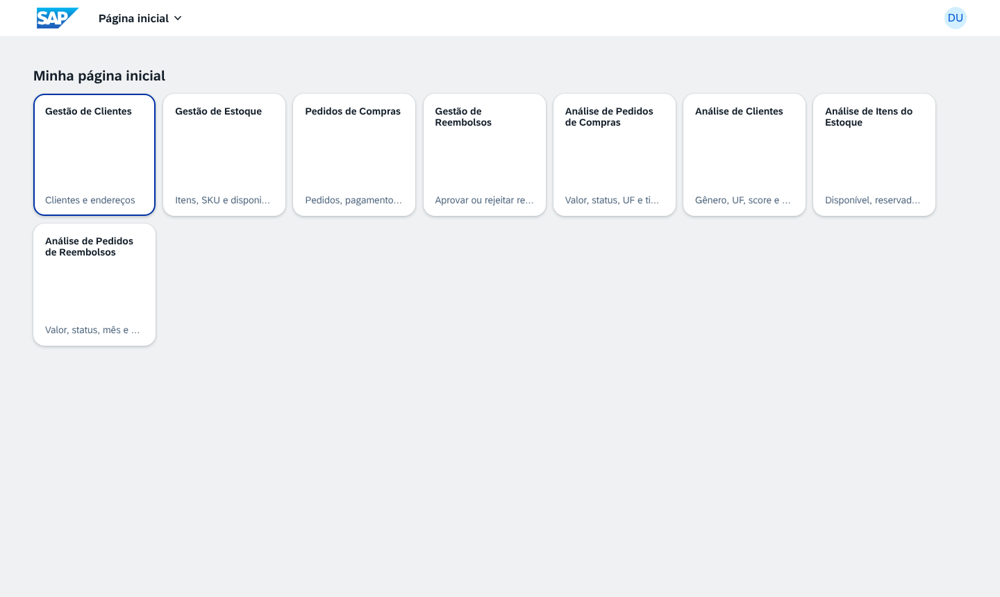
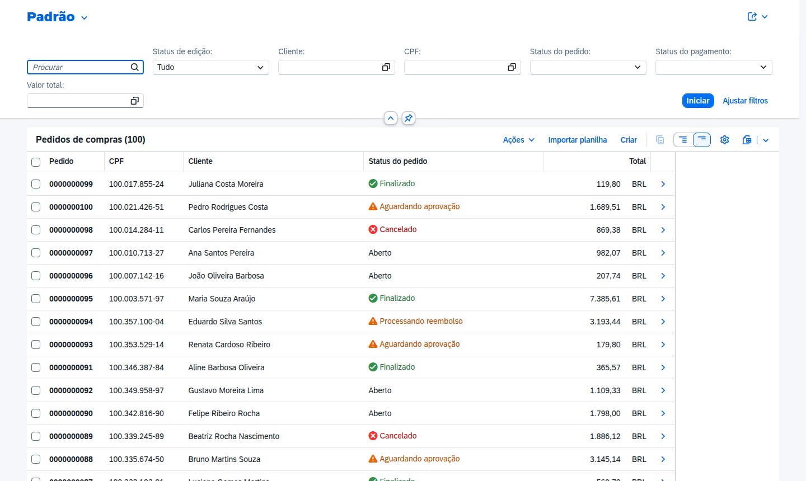
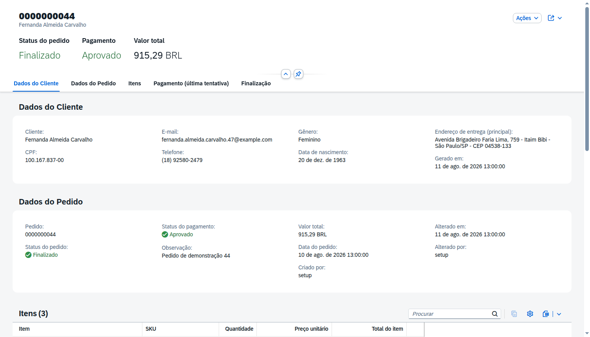
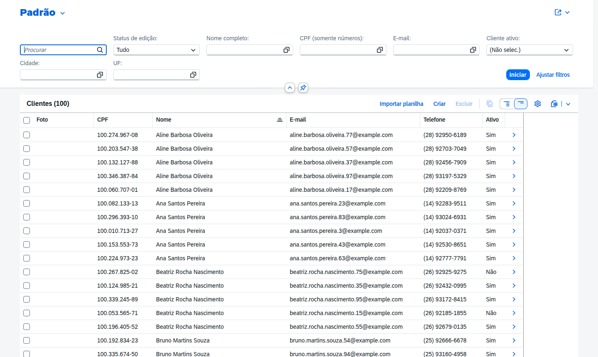
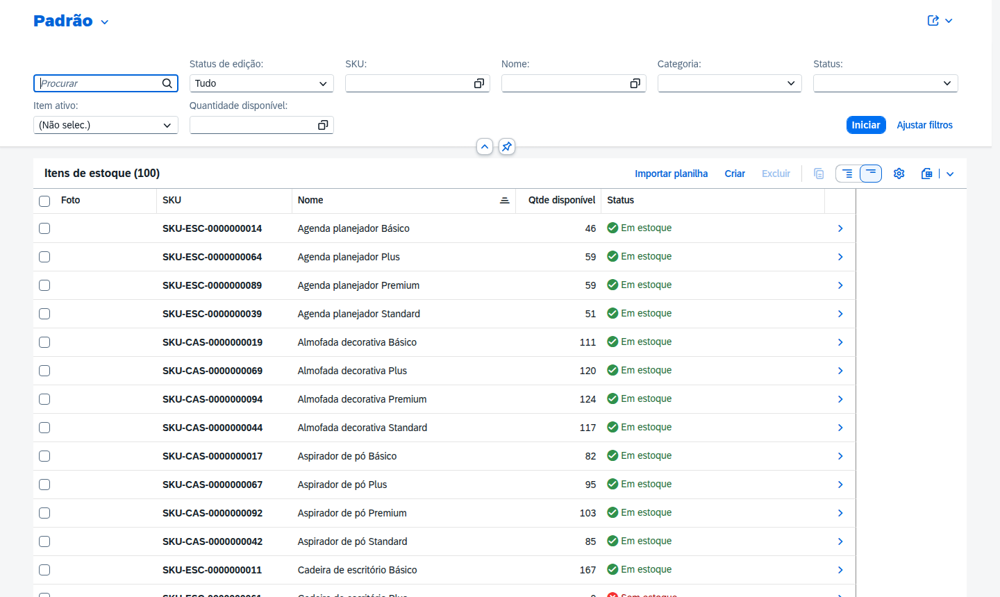
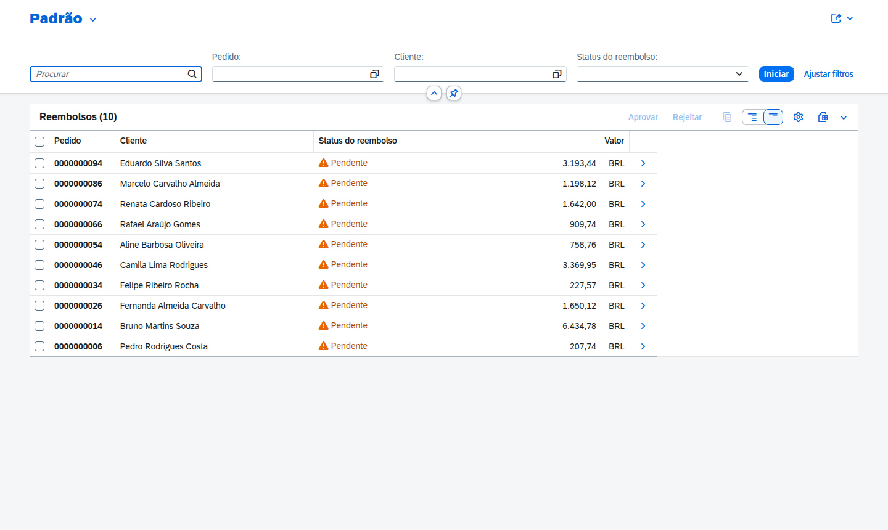
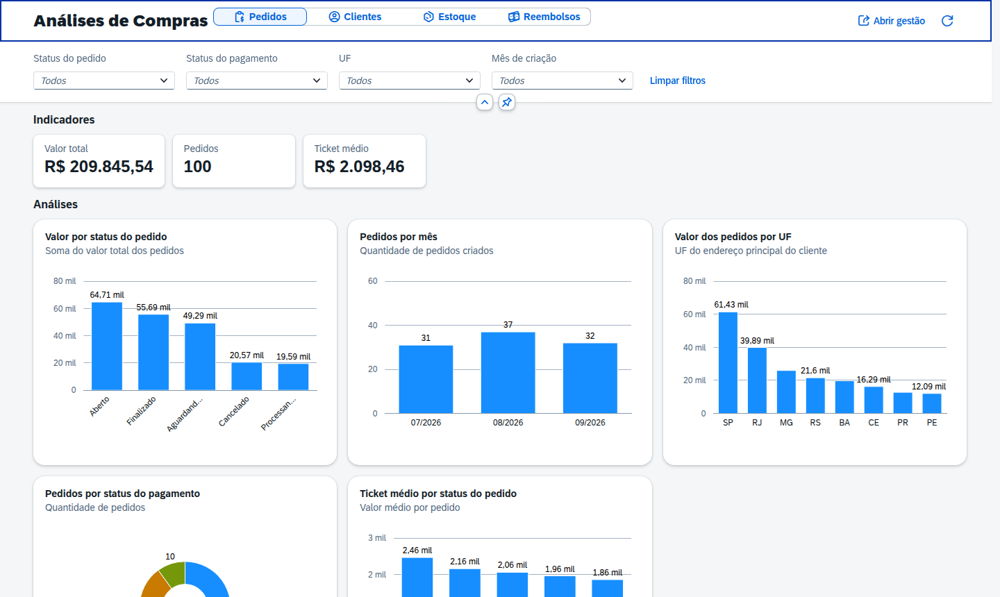
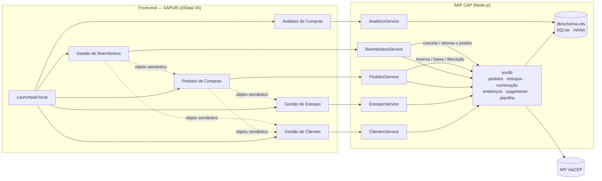
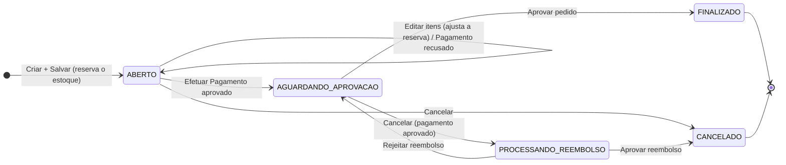
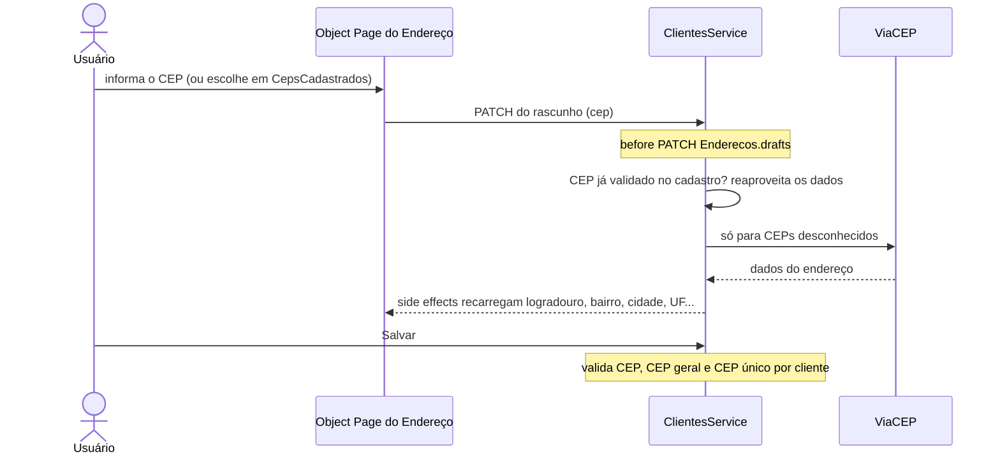

<h1 align="center">Pedidos de Compras – SAP CAP / Node.js</h1>

<p align="center">
  Cinco aplicações SAPUI5 — <b>Gestão de Clientes</b>, <b>Gestão de Estoque</b>, <b>Pedidos de Compras</b>,
  <b>Gestão de Reembolsos</b> e <b>Análises de Compras</b> — com backend em <b>SAP Cloud Application
  Programming Model (CAP)</b> sobre Node.js, em duas versões: <b>JavaScript</b> e <b>TypeScript</b>.
</p>

<p align="center">
  
  
  
  
  <br>
  
  
  
  
  
  <br>
  
  
  
  
</p>

---

## Índice

- [Sobre o projeto](#sobre-o-projeto)
- [Demonstração](#demonstração)
- [Funcionalidades](#funcionalidades)
- [Tecnologias](#tecnologias)
- [Arquitetura](#arquitetura)
  - [Fluxo do pedido](#fluxo-do-pedido)
- [Estrutura do repositório](#estrutura-do-repositório)
  - [Convenção de arquivos](#convenção-de-arquivos)
- [Pré-requisitos](#pré-requisitos)
- [Instalação e execução](#instalação-e-execução)
  - [Usuários de desenvolvimento](#usuários-de-desenvolvimento)
  - [Scripts](#scripts)
- [Front-end Fiori](#front-end-fiori)
- [Testes](#testes)
  - [Cenários de teste](#cenários-de-teste)
  - [Testes automatizados](#testes-automatizados)
- [Pedido: o que o usuário informa](#pedido-o-que-o-usuário-informa)
- [Endereço do cliente: consulta de CEP](#endereço-do-cliente-consulta-de-cep)
- [Endereço principal e CEP único](#endereço-principal-e-cep-único)
- [Reembolso de pedidos](#reembolso-de-pedidos)
- [Importação em massa por planilha](#importação-em-massa-por-planilha)
- [Rascunhos (draft)](#rascunhos-draft)
- [Análises](#análises)
- [Diferenças em relação ao RAP](#diferenças-em-relação-ao-rap)
- [Limitações conhecidas e pendências](#limitações-conhecidas-e-pendências)
- [Histórico de versões](#histórico-de-versões)
- [Documentação](#documentação)
- [Autor](#autor)

---

## Sobre o projeto

Porte para o **SAP CAP 10** da aplicação de Pedidos de Compras construída originalmente em
**SAP RAP / ABAP Cloud** ([sap-abap-rap-pedidos-de-compras-app](https://github.com/AdrianoBispo/sap-abap-rap-pedidos-de-compras-app),
pacote `ZAVBS_PC`). O repositório traz **duas implementações equivalentes** do mesmo sistema:

| Pasta | Implementação | Detalhes |
| --- | --- | --- |
| [`nodejs-padrao/`](nodejs-padrao) | JavaScript (ESM) | [README](nodejs-padrao/README.md) |
| [`nodejs-typescript/`](nodejs-typescript) | TypeScript `strict`, tipos gerados pelo `cds-typer` | [README](nodejs-typescript/README.md) |

As duas compartilham o mesmo modelo CDS, os mesmos serviços OData V4, as mesmas aplicações SAPUI5,
os mesmos dados de demonstração e a mesma suíte de testes. Muda apenas a linguagem dos handlers, das
regras de domínio, dos testes e dos scripts.

| App | O que gerencia | Serviço OData V4 | Equivalente RAP |
| --- | --- | --- | --- |
| Gestão de Clientes | Clientes e seus endereços, com preenchimento via ViaCEP | `ClientesService` (`/odata/v4/clientes`) | `ZUI_PC_CLIENTES` |
| Gestão de Estoque | Itens (SKU, foto, categoria, descrição), disponibilidade e status | `EstoqueService` (`/odata/v4/estoque`) | `ZUI_PC_ESTOQUE` |
| Pedidos de Compras | Pedidos, itens, pagamento simulado, cancelamento e histórico (snapshots) | `PedidosService` (`/odata/v4/pedidos`) | `ZUI_PC_PEDIDOS_COMPRAS` |
| Gestão de Reembolsos | Aprovação e rejeição de reembolsos de pedidos cancelados com pagamento aprovado | `ReembolsosService` (`/odata/v4/reembolsos`) | `ZUI_PC_REEMBOLSOS` |
| Análises de Compras | 20 análises (indicadores e gráficos) dos quatro domínios | `AnaliticoService` (`/odata/v4/analitico`) | `ZUI_PC_ANALITICO` |

> [!NOTE]
> Em desenvolvimento o banco é **SQLite em memória**, recriado a cada inicialização com os dados de
> demonstração. A conexão com o **SAP HANA Cloud** fica para a implantação (ver
> [Limitações conhecidas e pendências](#limitações-conhecidas-e-pendências)).

---

## Demonstração

<p align="center">
  
</p>

| Pedidos de Compras | Object Page do pedido |
| :----------------: | :-------------------: |
|  |  |

| Gestão de Clientes | Gestão de Estoque |
| :----------------: | :---------------: |
|  |  |

| Gestão de Reembolsos | Análises de Compras |
| :------------------: | :-----------------: |
|  |  |

---

## Funcionalidades

- **Clientes**: CRUD com rascunho, endereços como composição, ação *Definir como principal* e
  bloqueio de exclusão de cliente com pedido (gravado ou em rascunho).
- **Score do cliente**: sorteado (0–100) na criação, somente leitura, exibido em % numa barra
  vermelha (até 40), amarela (até 70) ou verde.
- **Endereço com ViaCEP**: ao informar o CEP o backend preenche logradouro, bairro, cidade, UF e
  estado; CEP já cadastrado é reaproveitado sem nova chamada; CEP geral de município exige logradouro
  e bairro; CEP único por cliente.
- **Estoque**: SKU `SKU-<3 letras da categoria>-<10 dígitos>` gerado no Save (e regenerado se a
  categoria muda); `qtdeDisponivel` e `statusEstoque` são colunas calculadas pelo banco; a reserva só
  é alterada pelos pedidos; inativação e exclusão controladas.
- **Pedidos**: o usuário informa **apenas o cliente e os itens**; endereço de entrega, dados do
  cliente, preços, totais, número e status são preenchidos pelo backend. O **Salvar** registra o
  pedido (`ABERTO`) e reserva o estoque; no pedido aberto só os **itens** mudam e a reserva é
  ajustada pela **diferença**. O pedido não é excluído — só **Efetuar Pagamento**, **Aprovar pedido**
  e **Cancelar pedido** (com motivo).
- **Pagamento simulado** por cartão (VISA/Mastercard): número, validade e CVV ficam só em memória;
  gravam-se bandeira, últimos 4 dígitos e máscara. A seção de pagamento é somente leitura e só a ação
  *Efetuar Pagamento* a preenche.
- **Object Page dinâmica do pedido**: *Dados do Cliente*, *Dados do Pedido*, *Itens*, *Pagamento* e,
  conforme o status, *Finalização* ou *Cancelamento*; cliente e itens vêm dos **snapshots** quando o
  pedido está `FINALIZADO` ou `CANCELADO`.
- **Reembolso**: cancelar um pedido com pagamento aprovado abre uma solicitação
  (`PROCESSANDO_REEMBOLSO`), decidida na app **Gestão de Reembolsos**.
- **Importação por planilha** (`.xlsx` ou `.csv`) em Clientes, Estoque e Pedidos, tudo ou nada.
- **Análises**: app freestyle com 20 análises sobre um serviço com agregações `$apply`.
- **Launchpad local** (sandbox do SAP Fiori launchpad) com os cinco tiles e navegação entre as apps
  por objetos semânticos: no pedido, Cliente e CPF abrem o cliente e Item e SKU abrem o item; no
  reembolso, o Pedido abre o pedido e Cliente e CPF abrem o cliente, sempre direto no registro.
- **Autorização** por papel: `Admin` e `Comum` (`@requires` / `@restrict`).
- **Concorrência** de estoque com `UPDATE` condicional atômico na transação da requisição.

---

## Tecnologias

| Camada | Tecnologia |
| --- | --- |
| Runtime | Node.js 22+, `@sap/cds` 10 (módulos ESM) |
| Linguagem | JavaScript (`nodejs-padrao`) e TypeScript 6 `strict` com `@cap-js/cds-typer` e `tsx` (`nodejs-typescript`) |
| Banco | SQLite em memória (`@cap-js/sqlite`) em desenvolvimento; SAP HANA Cloud na implantação (pendente) |
| Serviços | OData V4 com rascunho (draft), `@restrict`, `@assert`/`@mandatory`, side effects, `$apply` |
| Front-end | SAPUI5 1.148 (LTS): Fiori Elements V4 (List Report + Object Page) e app freestyle, servidos pelo `cds-plugin-ui5` |
| Integração | ViaCEP via `fetch` nativo (URL em `cds.requires.viacep`) |
| Ferramentas | `@sap/cds-dk` 10, SAP Fiori tools (geração das apps), UI5 linter, ESLint 10, `local-ssl-proxy` (HTTPS local) |
| Testes | `node:test` + `@cap-js/cds-test` (68 testes por versão), ViaCEP falso local |

---

## Arquitetura



Cada aplicação tem seu próprio serviço (como os `ZUI_PC_*` do RAP). As regras que atravessam
domínios — movimentação de estoque, snapshots, cancelamento e reembolso — ficam em `srv/lib` e rodam
sempre na transação da requisição: qualquer erro desfaz tudo.

### Fluxo do pedido

Cinco status: `ABERTO`, `AGUARDANDO_APROVACAO`, `PROCESSANDO_REEMBOLSO`, `CANCELADO` e `FINALIZADO`.
Status do pagamento: `PENDENTE`, `APROVADO`, `RECUSADO` e `DEVOLVIDO` (quando o reembolso é aprovado).



---

## Estrutura do repositório

```text
.
├── nodejs-padrao/                     implementação em JavaScript (ESM)
│   ├── _i18n/messages.properties      mensagens de negócio (porte da message class ZPC_MSG)
│   ├── app/
│   │   ├── common.cds                 rótulos, textos de CodeList, campos somente leitura
│   │   ├── services.cds               reúne as anotações das apps
│   │   ├── gestao-clientes/           Fiori Elements: annotations.cds + webapp/
│   │   ├── gestao-estoque/            Fiori Elements
│   │   ├── pedidos-compras/           Fiori Elements
│   │   ├── gestao-reembolsos/         Fiori Elements
│   │   ├── analise-compras/           SAPUI5 freestyle (20 análises)
│   │   ├── launchpad.html             sandbox do SAP Fiori launchpad
│   │   └── launchpad/                 configuração e inicialização do launchpad
│   ├── db/
│   │   ├── common.cds                 tipos e CodeLists
│   │   ├── schema.cds                 entidades (porte das tabelas ZTA_PC_*)
│   │   └── data/                      CodeLists e dados de demonstração (CSV)
│   ├── srv/
│   │   ├── *-service.cds              um serviço por aplicação + analitico-service.cds
│   │   ├── *-service.js               handlers (porte das behavior pools ZBP_R_PC_*)
│   │   ├── validacoes.cds             @mandatory / @assert
│   │   └── lib/                       regras de domínio reutilizáveis
│   ├── scripts/gerar-dados-demo.js    gerador dos CSVs de demonstração
│   └── test/                          testes automatizados
│
├── nodejs-typescript/                 implementação em TypeScript (mesma estrutura)
│   ├── srv/*.ts, srv/lib/*.ts         handlers e regras tipados com #cds-models/*
│   ├── test/*.test.ts                 testes em TypeScript
│   ├── scripts/gerar-dados-demo.ts
│   └── tsconfig.json, tsconfig.cdsbuild.json
│
├── docs/
│   ├── assets/                        imagens usadas neste README
│   ├── modelos-importacao/            modelos de planilha (.xlsx e .csv)
│   ├── especificacao-tecnica.md       especificação técnica (Markdown)
│   └── especificacao-tecnica.docx     especificação técnica (Word)
│
└── README.md
```

### Convenção de arquivos

| Arquivo | Conteúdo | Equivalente RAP |
| --- | --- | --- |
| `db/schema.cds`, `db/common.cds` | Entidades, tipos e CodeLists | Tabelas `ZTA_PC_*` + CDS `ZR_PC_*` + `ZTA_PC_CODELIST` |
| `db/data/*.csv` | Dados iniciais (`<namespace>-<Entidade>.csv`) | `ZCL_PC_SETUP` / `ZCL_SETUP_*` |
| `srv/*-service.cds` | Serviços e projeções expostas | Projections `ZC_PC_*_APP` + Service Definitions `ZUI_PC_*` |
| `srv/*-service.js` / `.ts` | Handlers (`before`/`on`/`after`) | Behavior pools `ZBP_R_PC_*` |
| `srv/validacoes.cds` | Validações declarativas | Validations simples das BDEFs |
| `srv/lib/*` | Regras de domínio reutilizáveis | Classes `ZCL_PC_*` e EML entre BOs |
| `app/<app>/annotations.cds` | Anotações de UI | Metadata Extensions `ZC_PC_*_APP` (`.ddlx`) |
| `app/<app>/webapp/manifest.json` | Rotas, páginas, tabelas, ações customizadas, tile | `manifest.json` das apps em `ui5/` |
| `_i18n/messages.properties` | Mensagens de negócio | Message Class `ZPC_MSG` |
| `test/*.test.js` / `.ts` | Testes automatizados | Classes de teste ABAP Unit |

---

## Pré-requisitos

- **Node.js 22** ou superior.
- `npm` (as apps usam *workspaces*: um único `npm install` por implementação).
- Opcional: `@sap/cds-dk` global (`cds` na linha de comando) — cada projeto já o tem como
  dependência de desenvolvimento.
- **VS Code** com *SAP CDS Language Support* e *SAP Fiori tools*, ou **SAP Business Application Studio**.
- Acesso à internet para o SAPUI5 (CDN `sapui5.hana.ondemand.com`) e para o ViaCEP.

---

## Instalação e execução

```sh
git clone https://github.com/AdrianoBispo/sap-cap-nodejs-pedidos-de-compras-app.git
cd sap-cap-nodejs-pedidos-de-compras-app/nodejs-padrao   # ou nodejs-typescript
npm install
npm run watch            # serviços + apps em http://localhost:4004
```

Abra `http://localhost:4004/launchpad.html` (launchpad com os cinco tiles) ou a página inicial do
CAP, que lista serviços e apps. O banco SQLite em memória é recriado a cada inicialização com os dados
de `db/data`: 100 clientes, 100 itens e 100 pedidos em todos os status (porte das classes
`ZCL_SETUP_*`). Para regenerar os CSVs: `npm run dados:demo`.

Para testar em **HTTPS** local (ex.: recursos do navegador que exigem contexto seguro), deixe o
`watch` rodando e, em outro terminal, execute `npm run https`: o `local-ssl-proxy` publica
`https://localhost:8443` apontando para a porta 4004 (certificado autoassinado).

### Usuários de desenvolvimento

Autenticação *mocked* do CAP:

| Usuário | Senha | Papel | Permissões |
| --- | --- | --- | --- |
| `admin` | `admin` | `Admin` | Tudo: clientes, estoque, pedidos, reembolsos, análises e importação |
| `comum` | `comum` | `Comum` | Consulta clientes e estoque; cria e opera pedidos (inclusive importação); decide reembolsos; análises |

### Scripts

| Script | JavaScript | TypeScript |
| --- | --- | --- |
| `npm run watch` | `cds watch` | `cds-tsx watch` (executa os `.ts` com `tsx`) |
| `npm test` | 68 testes (`node --test`) | `typer` + 68 testes (`node --import tsx --test`) |
| `npm run lint` | ESLint | ESLint + `typecheck` |
| `npm run typecheck` | — | `cds-typer` + `tsc --noEmit` |
| `npm run build` | — | `cds build --production` (JavaScript em `gen/srv`) |
| `npm run https` | Proxy HTTPS 8443 → 4004 | Proxy HTTPS 8443 → 4004 |
| `npm run dados:demo` | Regenera `db/data` | Regenera `db/data` |

---

## Front-end Fiori

Quatro apps **Fiori Elements OData V4** (List Report + Object Page), geradas com o **SAP Fiori tools**,
e uma app **SAPUI5 freestyle**. Ficam em `app/` de cada implementação e são servidas pelo próprio CAP
via `cds-plugin-ui5`. A UI é orientada a anotações: colunas, filtros, seções, ações, criticidade e
side effects vêm de `app/<app>/annotations.cds` e `app/common.cds`.

| App | Caminho | Páginas | Tile (objeto semântico) |
| --- | --- | --- | --- |
| Gestão de Clientes | `/gestaoclientes/index.html` | Cliente → Endereço | `Cliente-manage` |
| Gestão de Estoque | `/gestaoestoque/index.html` | Item | `ItemEstoque-manage` |
| Pedidos de Compras | `/pedidoscompras/index.html` | Pedido → Item do pedido / Item histórico | `PedidoCompra-manage` |
| Gestão de Reembolsos | `/gestaoreembolsos/index.html` | Reembolso | `Reembolso-manage` |
| Análises de Compras | `/analisecompras/index.html` | Painel por domínio → Detalhe da análise | `AnaliseCompras-display` |

- **Importar planilha**: ação customizada no List Report de Clientes, Estoque e Pedidos
  (`webapp/ext/ImportarPlanilha.js`), com diálogo de escolha de arquivo que chama a action
  `importarPlanilha` do serviço.
- **Itens do pedido** são criados na própria tabela (*inline*), só no rascunho.
- **Navegação entre apps** (no launchpad local): os campos abaixo viram links que abrem a Object
  Page do registro na app de destino, que o localiza pela chave semântica (`cpf`, `sku`,
  `numeroPedido`) recebida no contexto da navegação.

  | Origem | Campos com link | Destino |
  | --- | --- | --- |
  | Pedidos | Cliente, CPF | Gestão de Clientes (`Cliente-manage`, `cpfCliente` → `cpf`) |
  | Itens do pedido | Item, SKU | Gestão de Estoque (`ItemEstoque-manage`, `skuItem` → `sku`) |
  | Reembolsos | Pedido (link direto, `DataFieldWithIntentBasedNavigation`) | Pedidos de Compras (`PedidoCompra-manage`) |
  | Reembolsos | Cliente, CPF | Gestão de Clientes (`Cliente-manage`) |
- **Validação**: manifests na versão 2.0.0, UI5 linter sem apontamentos; telas conferidas no navegador.

---

## Testes

### Cenários de teste

Pelas apps (com `npm run watch`) ou chamando os serviços OData:

| Cenário | Como testar |
| --- | --- |
| Pagamento aprovado | Cartão `4111 1111 1111 1111` (VISA), validade futura (ex.: `12/30`), CVV `123` |
| Pagamento recusado | Mesmo cartão com CVV `000` (pedido permanece `ABERTO`; pagamento `RECUSADO`) |
| Mastercard | Cartão iniciado por `5` (ex.: `5555 5555 5555 4444`) |
| Dados de cartão inválidos | Validade vencida ou CVV com 2 dígitos → erro (não é recusa) |
| Item sem estoque | Incluir no rascunho um item com disponível zerado → bloqueado na hora (`ITEM_SEM_ESTOQUE`) |
| Reserva no Save | Salvar um rascunho válido → pedido `ABERTO` e `qtdeReservada` do item aumenta; estoque insuficiente → bloqueado |
| Edição de itens | Em pedido `ABERTO`: *Editar* → alterar quantidade, incluir ou remover item → *Salvar* ajusta a reserva só pela diferença |
| Campos somente leitura | No pedido, só *Cliente* (na criação) e os itens são editáveis; dados do cliente e pagamento são somente leitura |
| Concorrência | Editar um item no Estoque e, no meio tempo, registrar um pedido com ele: ao salvar o item a reserva feita pelo pedido é preservada |
| Exclusão de cliente | Excluir cliente com pedido → bloqueado (`CLIENTE_COM_PEDIDO`) |
| CEP duplicado | Dois endereços com o mesmo CEP no **mesmo** cliente → bloqueado (`CEP_DUPLICADO_CLIENTE`) |
| Reembolso | Pagar e cancelar um pedido → `PROCESSANDO_REEMBOLSO`; na Gestão de Reembolsos, aprovar (pedido `CANCELADO`, pagamento `DEVOLVIDO`) ou rejeitar (motivo obrigatório; pedido volta ao status anterior) |
| Perfil comum | Entrar como `comum`: Clientes e Estoque ficam somente para consulta |

Fluxo do pedido: **Criar** (rascunho, informando o cliente e os itens) → **Salvar** (registra e
reserva o estoque) → **Efetuar Pagamento** → **Aprovar pedido** (ou **Cancelar pedido** com motivo).

### Testes automatizados

```sh
npm test         # em nodejs-padrao ou nodejs-typescript
```

Os testes sobem o servidor com `cds.test`, usam um **ViaCEP falso local** (sem rede externa) e um
gerador mínimo de `.xlsx`. **São permanentes**, como a suíte ABAP Unit do RAP: devem ser mantidos e
ajustados junto com as regras de negócio. São 68 testes por versão, todos passando:

| Arquivo | Cobre | Classes de teste RAP equivalentes |
| --- | --- | --- |
| `unidade.test` | CPF, e-mail, telefone, imagens, status de estoque, SKU, pagamento simulado, leitor XLSX/CSV | `ltcl_digitos_cpf`, `ltcl_email_imagem`, `ltcl_estoque_endereco`, `ZCL_PC_PAGAMENTO_SIM`, `ZCL_PC_PLANILHA` |
| `clientes.test` | Rascunho, ViaCEP, CEP geral, CEP único, endereço principal, CPF, autorização, exclusão, foto | `ltcl_persistencia_endereco` |
| `estoque.test` | SKU, disponibilidade e status, concorrência com edição, inativação e exclusão | `ltcl_sku_item` |
| `pedidos.test` | Registro com reserva, edição pela diferença, pagamento, aprovação, cancelamento, reembolso, campos somente leitura | `ltcl_registro_pedido`, `ltcl_edicao_pedido`, `ltcl_ciclo_pedido` |
| `reembolsos.test` | Aprovar, rejeitar (motivo obrigatório), decisão única | `ltcl_reembolso` |
| `importacao.test` | Clientes, estoque e pedidos (tudo ou nada), reimportação de pedidos recusada e os modelos de `docs/modelos-importacao` | `ZCL_PC_IMPORTACAO` |
| `analitico.test` | Agregações `$apply` dos quatro domínios | — |

Os testes rodam sem o `cds-plugin-ui5` (`CDS_PLUGIN_UI5_ACTIVE=false`), porque exercitam só o backend.

---

## Pedido: o que o usuário informa

No pedido de compras o usuário informa **somente o Cliente** (na criação) e os **itens**; todo o
resto é preenchido automaticamente:

| Campo | Origem |
| --- | --- |
| CPF, e-mail, telefone, gênero, data de nascimento | Associação `cliente` (somente leitura, `@Core.Computed`) |
| Endereço de entrega | Endereço principal do cliente, definido pelo backend ao escolher o cliente |
| Número, status do pedido e do pagamento, total | Backend (registro, ações e recálculo dos itens) |
| Preço unitário e total de cada item | Backend: preço do estoque no rascunho; preço fixado no registro |
| Pagamento (método, status, bandeira, cartão mascarado, autorização, mensagem, data) | Só a ação *Efetuar Pagamento* (`Pagamentos` é `@readonly` no serviço) |
| Observação | Somente leitura na tela; preenchida pela importação por planilha |
| Referência de importação | Coluna Pedido da planilha; gravada só pela importação (impede reimportar o mesmo pedido) |

Depois do registro o cliente fica somente leitura (`Common.FieldControl` por expressão) e, no
servidor, a troca é recusada (`PEDIDO_CLIENTE_IMUTAVEL`). Campos mantidos pelo backend que chegam
num PATCH do rascunho são descartados.

---

## Endereço do cliente: consulta de CEP

A consulta do CEP é feita inteiramente no backend. Na app, o **CEP** é um campo padrão do Fiori
Elements, com value help dos CEPs já cadastrados.



1. A entidade `CepsCadastrados` (value help) sugere os CEPs já validados (um por CEP, sem CEP geral).
2. No PATCH do rascunho, `preencherEnderecoPorCep` grava logradouro, bairro, cidade, UF, estado,
   `cepGeral` e `cepStatus` (`V` validado, `I` inválido, `X` indisponível). ViaCEP fora do ar gera
   um aviso, e o Save fica bloqueado até a consulta funcionar.
3. Para **CEP geral de município** (o ViaCEP não devolve logradouro/bairro), esses dois campos ficam
   editáveis e obrigatórios (`controleCampoCep` = 7); nos demais casos são somente leitura.
4. O side effect `Common.SideEffects#Cep` faz a UI recarregar os campos logo após o CEP.
5. A URL do ViaCEP vem de `cds.requires.viacep.credentials.url`; os testes a trocam por um servidor
   falso local.

---

## Endereço principal e CEP único

- **Primeiro endereço vira principal** automaticamente; a ação **Definir como principal** (no
  rascunho ou no cliente ativo) desmarca os demais.
- **CEP único por cliente, não global**: o mesmo cliente não pode ter dois endereços com o mesmo CEP
  (validação no Save + restrição `UNIQUE (cliente_ID, cep)` no banco), mas clientes diferentes podem
  compartilhar um CEP.
- **CEP pode ser alterado** depois de gravado: no CAP a chave do endereço é só o `ID`. (No RAP o CEP
  fazia parte da chave da tabela e ficava somente leitura.)

---

## Reembolso de pedidos

Quando **Cancelar pedido** é acionado sobre um pedido cujo pagamento está `APROVADO`, o cancelamento
não é direto: o backend abre um processo de reembolso.

1. `cancelarPedido` cria a solicitação em `Reembolsos` (status `PENDENTE`, guardando o status anterior
   do pedido) e move o pedido para `PROCESSANDO_REEMBOLSO`, mantendo a reserva de estoque.
2. **Aprovar reembolso** (app Gestão de Reembolsos): libera a reserva, gera os snapshots, cancela o
   pedido com `dataCancelamento`, marca o pagamento como `DEVOLVIDO` e o reembolso como `APROVADO`,
   na mesma transação.
3. **Rejeitar reembolso** (motivo obrigatório): o pedido volta ao status anterior, o motivo do
   cancelamento é limpo e o reembolso fica `REJEITADO`.

As duas ações só ficam disponíveis com o reembolso `PENDENTE` (`Core.OperationAvailable`).

---

## Importação em massa por planilha

As apps **Gestão de Clientes**, **Gestão de Estoque** e **Pedidos de Compras** têm o botão
**Importar planilha** na lista. Ele abre um diálogo para escolher um arquivo `.xlsx` ou `.csv` e cria
os registros de uma vez. Modelos prontos estão em [`docs/modelos-importacao/`](docs/modelos-importacao).

| App | Linha da planilha | Colunas (obrigatórias em **negrito**) |
| --- | --- | --- |
| Clientes | um cliente com o endereço principal | **CPF**, **Nome**, **E-mail**, **Telefone**, Gênero, **Data de nascimento**, **CEP**, **Número**, Complemento |
| Estoque | um item | **Nome**, Descrição, **Categoria**, **Quantidade em estoque**, **Preço unitário**, Moeda (padrão `BRL`) |
| Pedidos | um item de um pedido | **Pedido** (referência que agrupa as linhas), **CPF**, **SKU**, **Quantidade**, Observação |

- A primeira linha não vazia é o cabeçalho; nomes de coluna sem diferença de acento, caixa ou
  pontuação, e com sinônimos. CSV com `;`, `,` ou tabulação, UTF-8 (com ou sem BOM) ou Windows-1252.
- XLSX lido sem bibliotecas externas (ZIP + XML): aceita textos compartilhados e *inline* (inclusive
  arquivos do LibreOffice). `.xls` antigo não é aceito. Máximo de **500 linhas**.
- **Tudo ou nada**: todas as linhas são validadas antes de gravar; qualquer erro cancela a importação
  e lista o motivo por linha (no máximo 15, mais o total omitido).
- A criação passa pelo próprio serviço, então valem as mesmas regras da tela (CPF, ViaCEP, SKU,
  número do pedido, reserva de estoque).
- **Sem duplicidade**: clientes (CPF) e itens (nome) já cadastrados são recusados. Nos pedidos, a
  coluna **Pedido** é gravada como *Referência de importação* (somente leitura, até 40 caracteres) e
  funciona como chave de idempotência: a mesma referência para o mesmo cliente é recusada enquanto
  houver pedido não cancelado com ela (`Linha 2: o pedido P001 do cliente 100.003.571-97 já foi
  importado (pedido 0000000101).`). Reenviar a mesma planilha não cria pedidos repetidos; outro
  cliente pode usar a mesma referência, e um pedido cancelado a libera.
- Clientes e Estoque exigem o papel `Admin`; Pedidos, `Comum` ou `Admin`.

---

## Rascunhos (draft)

Clientes (com endereços), Itens e Pedidos (com itens, pagamento e snapshots) usam o rascunho do CAP
(`@odata.draft.enabled`). As tabelas de rascunho são geradas automaticamente
(`<Serviço>_<Entidade>_drafts`); não há tabelas `_D` a manter, como no RAP. Eventos usados:

| Evento | Onde | Uso |
| --- | --- | --- |
| `NEW` | `*.drafts` | Valores iniciais (status, moeda, cliente ativo, score, endereço principal) |
| `PATCH` | `*.drafts` | Endereço pelo CEP, endereço do pedido pelo cliente, preço e total dos itens, descarte de campos do backend |
| `EDIT` | entidade ativa | Pedido só é editado em `ABERTO` |
| `CREATE` / `UPDATE` | entidade ativa (Salvar) | Validações, SKU, registro do pedido e reserva pela diferença |
| `DISCARD` | `ItensPedido.drafts` | Recalcula o total do rascunho ao excluir uma linha |

---

## Análises

Camada analítica **somente leitura**: `AnaliticoService` expõe `PedidosAnalise`, `ClientesAnalise`,
`ItensAnalise` e `ReembolsosAnalise`, com dimensões e medidas (`@Aggregation.default`, expostas como
*custom aggregates*), o que permite `$apply=groupby/aggregate` no servidor.

O front-end é a app **freestyle** `analise-compras` (porte da app do projeto RAP): um painel por
domínio (Pedidos, Clientes, Estoque, Reembolsos) com barra de filtros, indicadores e 5 gráficos cada,
num total de 20 análises, e uma página de detalhe por análise.

---

## Diferenças em relação ao RAP

| Tema | RAP (`ZAVBS_PC`) | CAP |
| --- | --- | --- |
| Persistência | Tabelas `ZTA_PC_*` + `ZTA_PC_*_D` | Entidades CDS; tabelas de rascunho geradas |
| Numeração | Number Range Object `ZPC_NR` | Tabela `Numeracoes` com incremento atômico na transação |
| Disponível/status do estoque | Colunas mantidas por determinations | Colunas geradas (`stored`) no banco |
| Object Page dinâmica | Colunas `xfeld` persistidas (`AtualizarFlagsStatus`) | Elementos calculados na leitura |
| CEP do endereço | Chave da tabela, somente leitura após gravar | Chave é só o `ID`: o CEP pode ser alterado |
| Concorrência de estoque | Lock do BO Item via EML | `UPDATE` condicional atômico |
| Autorização | IAM App, objetos `ZPC_ADMIN`/`ZPC_PEDIDO`, `c_modo_trial` | Papéis `Admin`/`Comum` com `@requires`/`@restrict` |
| Mensagens | Message Class `ZPC_MSG` (73 caracteres) | `_i18n/messages.properties` com parâmetros nomeados |
| Leitor XLSX | XCO (sem `inlineStr`, recusa LibreOffice) | Leitor próprio (ZIP + XML), aceita ambos |
| Testes | ABAP Unit | `node:test` + `@cap-js/cds-test` |
| Launchpad | Fiori Launchpad / SAP Build Work Zone | Sandbox local (`launchpad.html`) |

---

## Limitações conhecidas e pendências

- **SAP HANA Cloud**: a conexão fica para a implantação (`cds add hana`, `cds add xsuaa,mta`). O
  modelo usa funções portáveis do CAP e colunas geradas suportadas pelo HANA, mas a execução sobre o
  HANA Cloud ainda não foi testada.
- **Autenticação de produção** (XSUAA/IAS) e descritor MTA ainda não configurados; em desenvolvimento
  a autenticação é *mocked*.
- **Launchpad local**: o sandbox do SAPUI5 1.148 mostra, além dos cinco tiles, o grupo padrão
  *Sample Applications* do próprio sandbox.
- **Object Page**: as seções são carregadas sob demanda; ao abrir um pedido a página pode começar
  rolada para *Dados do Pedido* — role para cima ou use a barra de seções para ver *Dados do Cliente*.
- **Dados do cartão** aparecem sem máscara no diálogo da ação (parâmetros de action do Fiori Elements);
  não são gravados nem registrados em log.

---

## Histórico de versões

| Versão | Mudanças |
| --- | --- |
| v1.4 | Importação de pedidos sem duplicidade: a coluna Pedido vira a *Referência de importação* do pedido, e a mesma referência para o mesmo cliente é recusada enquanto houver pedido não cancelado com ela; 68 testes por versão; especificação técnica 2.1 |
| v1.3 | Navegação entre aplicações: no pedido, Cliente/CPF → Gestão de Clientes e Item/SKU → Gestão de Estoque; no reembolso, Pedido → Pedidos de Compras e Cliente/CPF → Gestão de Clientes; `skuItem` em `ItensPedido` e CPF sem formatação em `Reembolsos` para o contexto da navegação |
| v1.2 | Correção no pedido: só o cliente (na criação) e os itens são informados; dados do cliente lidos pela associação e somente leitura (antes apareciam editáveis e obrigatórios e ficavam vazios no rascunho); pagamento e snapshots somente leitura, gravados só pelas ações; observação somente leitura na tela; testes de regressão (66 por versão); README principal no modelo do projeto RAP |
| v1.1 | Versão TypeScript (`nodejs-typescript`, `cds-typer`, `tsx`); especificação técnica 2.0 (.md e .docx); proxy HTTPS local (`npm run https`) |
| v1.0 | Versão JavaScript (`nodejs-padrao`): modelo, serviços, regras de negócio, cinco apps SAPUI5, launchpad local, importação por planilha, camada analítica, dados de demonstração e suíte de testes |

---

## Documentação

- [Especificação técnica](docs/especificacao-tecnica.md) (Markdown) e
  [versão Word](docs/especificacao-tecnica.docx).
- [README da implementação JavaScript](nodejs-padrao/README.md).
- [README da implementação TypeScript](nodejs-typescript/README.md).
- [Modelos de importação](docs/modelos-importacao).
- Projeto original em RAP: [sap-abap-rap-pedidos-de-compras-app](https://github.com/AdrianoBispo/sap-abap-rap-pedidos-de-compras-app).

---

## Autor

Desenvolvido por **Adriano Bispo**.

[](https://github.com/AdrianoBispo)
