<h1 align="center">Pedidos de Compras – SAP CAP / Node.js</h1>

<p align="center">
  Oito aplicações SAPUI5 — quatro de gestão (<b>Clientes</b>, <b>Estoque</b>, <b>Pedidos de Compras</b> e
  <b>Reembolsos</b>) e quatro de análise (<b>Pedidos de Compras</b>, <b>Clientes</b>, <b>Itens do Estoque</b> e
  <b>Pedidos de Reembolsos</b>) — com backend em <b>SAP Cloud Application Programming Model (CAP)</b> sobre
  Node.js, em duas versões: <b>JavaScript</b> e <b>TypeScript</b>.
</p>

<p align="center">
  
  
  
  
  <br>
  
  
  
  
  
  <br>
  
  
  
  
</p>

---

## Índice

- [Sobre o projeto](#sobre-o-projeto)
- [Demonstração](#demonstração)
- [Funcionalidades](#funcionalidades)
- [Tecnologias](#tecnologias)
- [Arquitetura](#arquitetura)
  - [Arquitetura na SAP BTP (implantação)](#arquitetura-na-sap-btp-implantação)
  - [Fluxo do pedido](#fluxo-do-pedido)
- [Diagramas dos processos](#diagramas-dos-processos)
- [Estrutura do repositório](#estrutura-do-repositório)
  - [Convenção de arquivos](#convenção-de-arquivos)
- [Pré-requisitos](#pré-requisitos)
- [Instalação e execução](#instalação-e-execução)
  - [Usuários de desenvolvimento](#usuários-de-desenvolvimento)
  - [Scripts](#scripts)
- [Front-end Fiori](#front-end-fiori)
- [Testes](#testes)
  - [Cenários de teste](#cenários-de-teste)
  - [Testes automatizados](#testes-automatizados)
- [Pedido: o que o usuário informa](#pedido-o-que-o-usuário-informa)
- [Endereço do cliente: consulta de CEP](#endereço-do-cliente-consulta-de-cep)
- [Endereço principal e CEP único](#endereço-principal-e-cep-único)
- [Reembolso de pedidos](#reembolso-de-pedidos)
- [Importação em massa por planilha](#importação-em-massa-por-planilha)
- [Rascunhos (draft)](#rascunhos-draft)
- [Análises](#análises)
- [Limitações conhecidas e pendências](#limitações-conhecidas-e-pendências)
- [Histórico de versões](#histórico-de-versões)
- [Documentação](#documentação)
- [Autor](#autor)

---

## Sobre o projeto

Sistema de Pedidos de Compras em **SAP CAP 10**: cadastro de clientes e de itens de estoque, pedidos
com reserva de estoque, pagamento simulado, reembolsos, importação por planilha e análises. O
repositório traz **duas implementações equivalentes** do mesmo sistema:

| Pasta | Implementação | Detalhes |
| --- | --- | --- |
| [`nodejs-padrao/`](nodejs-padrao) | JavaScript (ESM) | [README](nodejs-padrao/README.md) |
| [`nodejs-typescript/`](nodejs-typescript) | TypeScript `strict`, tipos gerados pelo `cds-typer` | [README](nodejs-typescript/README.md) |

As duas compartilham o mesmo modelo CDS, os mesmos serviços OData V4, as mesmas aplicações SAPUI5,
os mesmos dados de demonstração e a mesma suíte de testes. Muda apenas a linguagem dos handlers, das
regras de domínio, dos testes e dos scripts.

| App | O que gerencia | Serviço OData V4 |
| --- | --- | --- |
| Gestão de Clientes | Clientes e seus endereços, com preenchimento via ViaCEP | `ClientesService` (`/odata/v4/clientes`) |
| Gestão de Estoque | Itens (SKU, foto, categoria, descrição), disponibilidade e status | `EstoqueService` (`/odata/v4/estoque`) |
| Pedidos de Compras | Pedidos, itens, pagamento simulado, cancelamento e histórico (snapshots) | `PedidosService` (`/odata/v4/pedidos`) |
| Gestão de Reembolsos | Aprovação e rejeição de reembolsos de pedidos cancelados com pagamento aprovado | `ReembolsosService` (`/odata/v4/reembolsos`) |
| Análise de Pedidos de Compras | Indicadores e 5 gráficos dos pedidos (valor, status, pagamento, UF, mês) | `AnaliticoService` (`/odata/v4/analitico`) |
| Análise de Clientes | Indicadores e 5 gráficos dos clientes (gênero, UF, score, cadastros) | `AnaliticoService` |
| Análise de Itens do Estoque | Indicadores e 5 gráficos do estoque (categoria, situação, reservas, valor) | `AnaliticoService` |
| Análise de Pedidos de Reembolsos | Indicadores e 5 gráficos dos reembolsos (status, mês, UF, motivo) | `AnaliticoService` |

> [!NOTE]
> Em desenvolvimento o banco é **SQLite em arquivo** (`db.sqlite`), criado na primeira execução com os
> dados de demonstração e mantido entre reinícios. Em produção o perfil `[production]` usa o
> **SAP HANA Cloud** (`@cap-js/hana`); a implantação ainda é pendente (ver
> [Limitações conhecidas e pendências](#limitações-conhecidas-e-pendências)).

---

## Demonstração

<p align="center">
  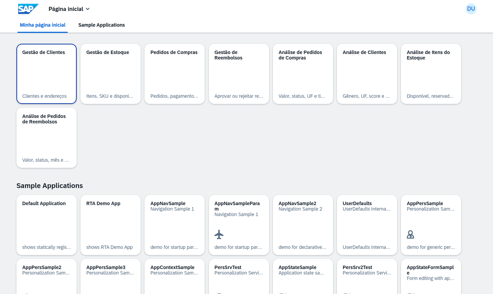
</p>

| Pedidos de Compras | Object Page do pedido |
| :----------------: | :-------------------: |
| 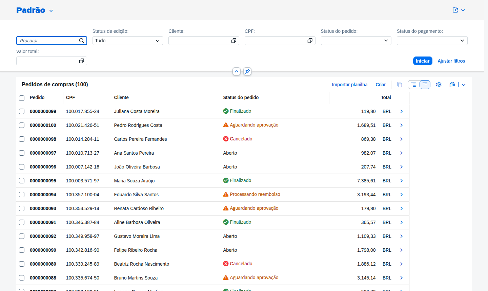 | 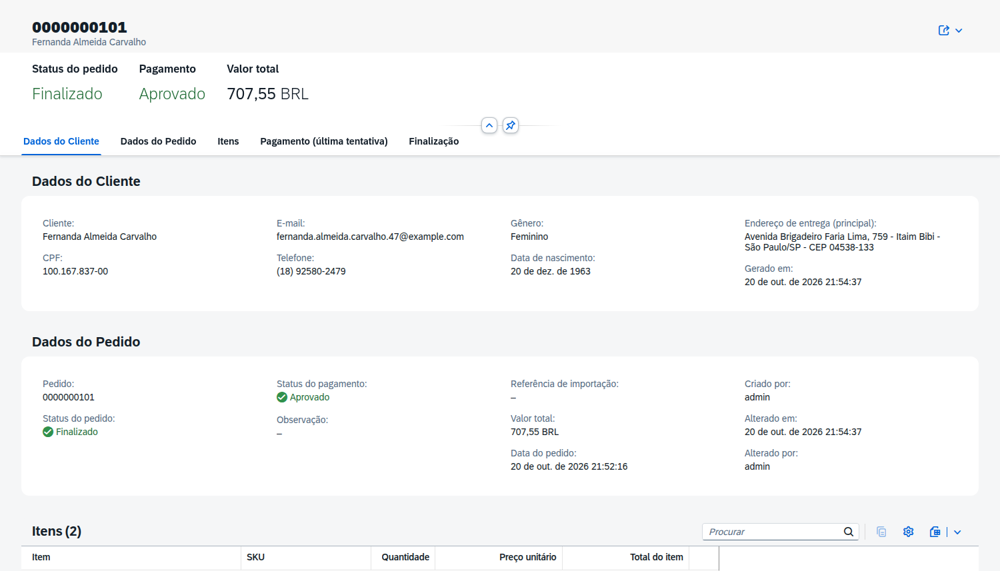 |

| Gestão de Clientes | Gestão de Estoque |
| :----------------: | :---------------: |
| 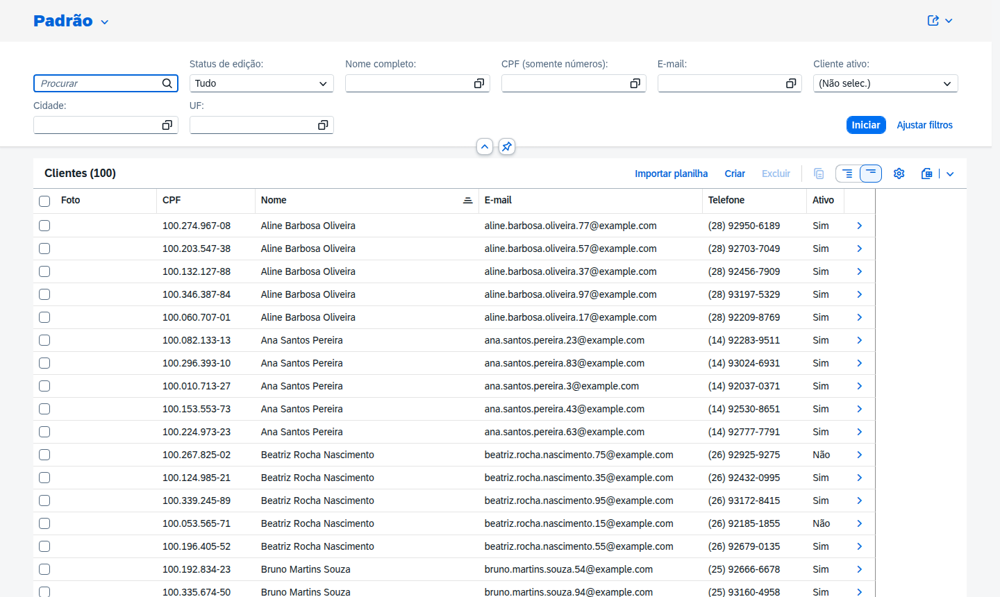 | 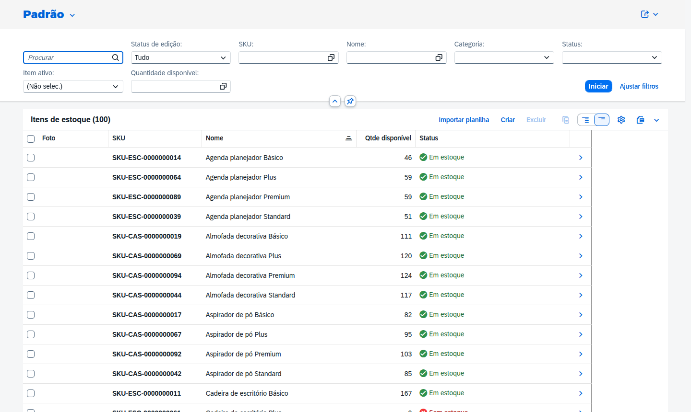 |

| Gestão de Reembolsos | Efetuar Pagamento (campos com máscara) |
| :------------------: | :------------------------------------: |
| 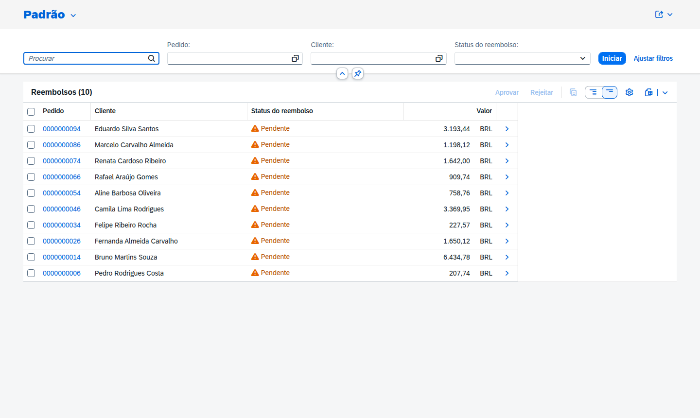 | 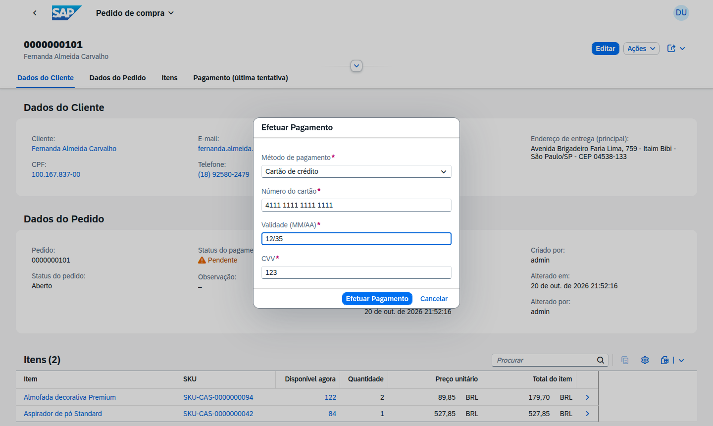 |

| Análise de Pedidos de Compras | Análise de Clientes |
| :---------------------------: | :-----------------: |
| 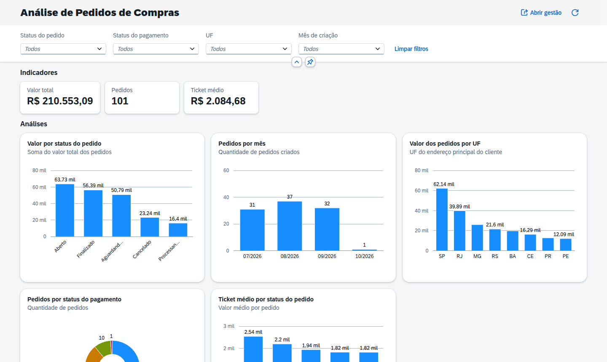 | 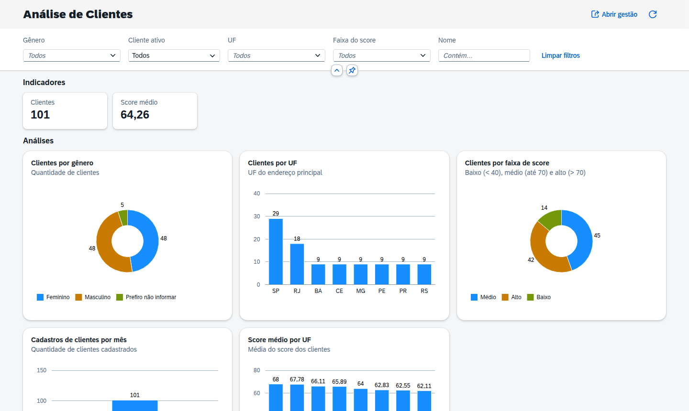 |

| Análise de Itens do Estoque | Análise de Pedidos de Reembolsos |
| :-------------------------: | :------------------------------: |
| 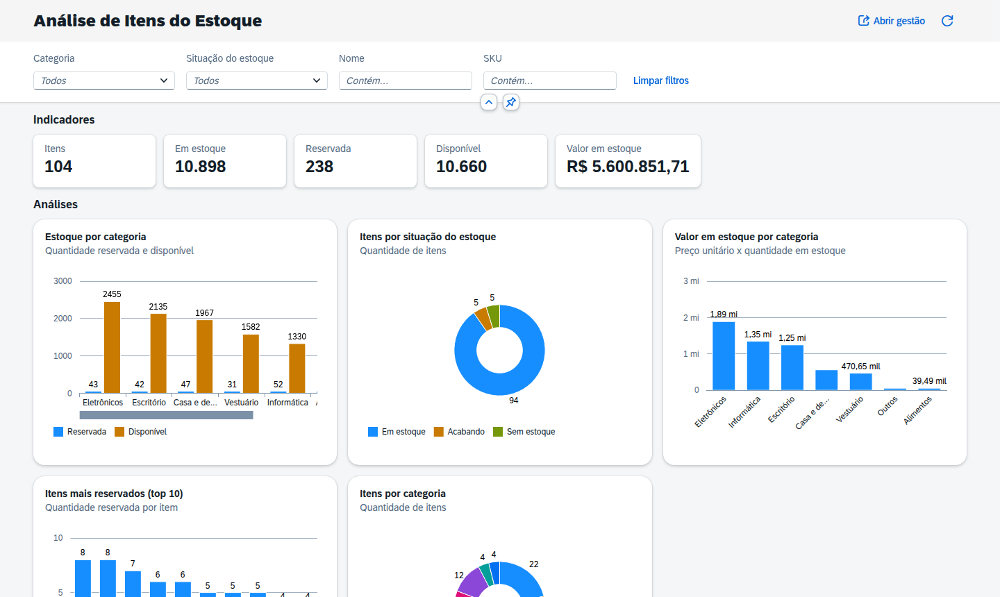 | 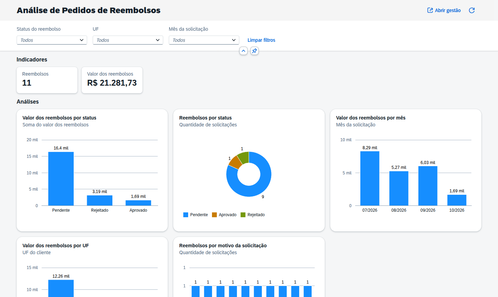 |

---

## Funcionalidades

- **Clientes**: CRUD com rascunho, endereços como composição, ação *Definir como principal* e
  bloqueio de exclusão de cliente com pedido (gravado ou em rascunho).
- **Score do cliente**: sorteado (0–100) na criação, somente leitura, exibido em % numa barra
  vermelha (até 40), amarela (até 70) ou verde.
- **Endereço com ViaCEP**: ao informar o CEP o backend preenche logradouro, bairro, cidade, UF e
  estado; CEP já cadastrado é reaproveitado sem nova chamada; CEP geral de município exige logradouro
  e bairro; CEP único por cliente.
- **Estoque**: SKU `SKU-<3 letras da categoria>-<10 dígitos>` gerado no Save (e regenerado se a
  categoria muda); `qtdeDisponivel` e `statusEstoque` são colunas calculadas pelo banco; a reserva só
  é alterada pelos pedidos; inativação e exclusão controladas.
- **Pedidos**: o usuário informa **apenas o cliente e os itens**; endereço de entrega, dados do
  cliente, preços, totais, número e status são preenchidos pelo backend. O **Salvar** registra o
  pedido (`ABERTO`) e reserva o estoque; no pedido aberto só os **itens** mudam e a reserva é
  ajustada pela **diferença**. O pedido não é excluído — só **Efetuar Pagamento**, **Aprovar pedido**
  e **Cancelar pedido** (com motivo).
- **Pagamento simulado** por cartão (VISA/Mastercard): o diálogo de *Efetuar Pagamento* tem máscara
  de digitação no número do cartão (`9999 9999 9999 9999`), na validade (`MM/AA`) e no CVV (`999`).
  Número, validade e CVV ficam só em memória; gravam-se bandeira, últimos 4 dígitos e máscara. A seção
  de pagamento é somente leitura e só a ação *Efetuar Pagamento* a preenche.
- **Object Page dinâmica do pedido**: *Dados do Cliente*, *Dados do Pedido*, *Itens*, *Pagamento* e,
  conforme o status, *Finalização* ou *Cancelamento*; cliente e itens vêm dos **snapshots** quando o
  pedido está `FINALIZADO` ou `CANCELADO`.
- **Reembolso**: cancelar um pedido com pagamento aprovado abre uma solicitação
  (`PROCESSANDO_REEMBOLSO`), decidida na app **Gestão de Reembolsos**.
- **Importação por planilha** (`.xlsx` ou `.csv`) em Clientes, Estoque e Pedidos, tudo ou nada.
- **Análises**: quatro apps freestyle, uma por domínio (pedidos, clientes, estoque e reembolsos),
  cada uma com barra de filtros, indicadores, 5 gráficos e página de detalhe, sobre um serviço com
  agregações `$apply`; o botão *Abrir gestão* leva à app de gestão do domínio.
- **Launchpad local** (sandbox do SAP Fiori launchpad) com os oito tiles e navegação entre as apps
  por objetos semânticos, sempre direto no registro: no pedido, Cliente e CPF abrem o cliente, Item e
  SKU abrem o item e *Solicitação de reembolso* abre o reembolso do pedido; no histórico do pedido
  (snapshots), cliente e item também abrem as apps de origem; no reembolso, o Pedido abre o pedido e
  Cliente e CPF abrem o cliente.
- **Autorização** por papel: `Admin` e `Comum` (`@requires` / `@restrict`). Para o usuário só de
  consulta, as apps de Clientes e Estoque escondem Criar, Editar, Excluir, Importar e *Definir como
  principal* (singleton `Permissoes`).
- **Concorrência**: movimentos de estoque e mudanças de status do pedido e do reembolso são `UPDATE`
  condicionais atômicos na transação da requisição. De duas ações simultâneas sobre o mesmo pedido
  (ex.: dois cancelamentos, ou pagar e cancelar) só a primeira vale; a outra é recusada
  (`PEDIDO_ALTERADO_CONCORRENTE`) sem mexer no estoque, no pagamento ou nos snapshots.

---

## Tecnologias

| Camada | Tecnologia |
| --- | --- |
| Runtime | Node.js 22+, `@sap/cds` 10 (módulos ESM) |
| Linguagem | JavaScript (`nodejs-padrao`) e TypeScript 6 `strict` com `@cap-js/cds-typer` e `tsx` (`nodejs-typescript`) |
| Banco | SQLite em arquivo (`@cap-js/sqlite`, `db.sqlite`) em desenvolvimento; SAP HANA Cloud (`@cap-js/hana`, perfil `[production]`) em produção, implantação pendente |
| Serviços | OData V4 com rascunho (draft), `@restrict`, `@assert`/`@mandatory`, side effects, `$apply` |
| Front-end | SAPUI5 1.148 (LTS): Fiori Elements V4 (List Report + Object Page) e apps freestyle, servidos pelo `cds-plugin-ui5` |
| Integração | ViaCEP via `fetch` nativo (URL em `cds.requires.viacep`) |
| Ferramentas | `@sap/cds-dk` 10, SAP Fiori tools (geração das apps), UI5 linter, ESLint 10, `local-ssl-proxy` (HTTPS local) |
| Testes | `node:test` + `@cap-js/cds-test` (74 testes em JavaScript, 76 em TypeScript), ViaCEP falso local |

---

## Arquitetura

<p align="center">
  <a href="assets/diagramas/diagrama-arquitetura.png">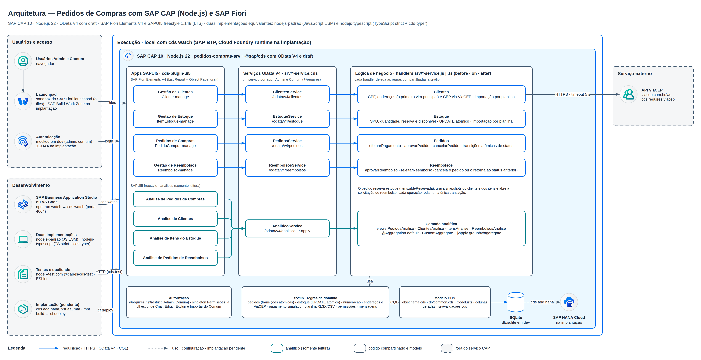</a>
</p>

Diagrama feito no draw.io com as formas oficiais da SAP; o arquivo editável, com esta e as páginas da
seção [Diagramas dos processos](#diagramas-dos-processos), está em
[`docs/arquitetura-e-processos.drawio`](docs/arquitetura-e-processos.drawio).

<details>
<summary>Versão em Mermaid</summary>

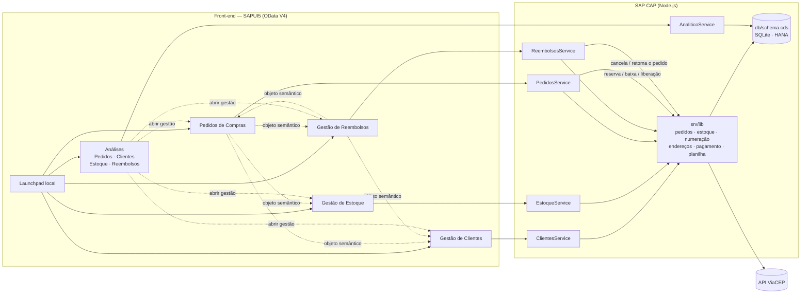

</details>

Cada aplicação tem seu próprio serviço OData. As regras que atravessam
domínios — movimentação de estoque, snapshots, cancelamento e reembolso — ficam em `srv/lib` e rodam
sempre na transação da requisição: qualquer erro desfaz tudo.

### Arquitetura na SAP BTP (implantação)

<p align="center">
  <a href="assets/diagramas/diagrama-arquitetura-btp.png">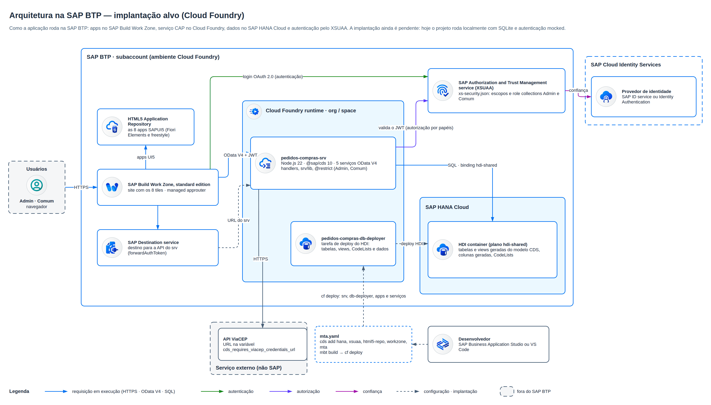</a>
</p>

Arquitetura alvo da implantação, ainda pendente (veja
[Limitações conhecidas e pendências](#limitações-conhecidas-e-pendências)). Hoje o projeto roda
localmente com SQLite e autenticação *mocked*.

- **SAP Build Work Zone, standard edition**: site com os 8 tiles e approuter gerenciado. As apps SAPUI5
  ficam no **HTML5 Application Repository**, e o **Destination service** aponta para a API do serviço
  CAP, repassando o token do usuário (`forwardAuthToken`).
- **SAP BTP, Cloud Foundry runtime**:
  - `pedidos-compras-srv`: Node.js 22 com `@sap/cds` 10 e os 5 serviços OData V4.
  - `pedidos-compras-db-deployer`: tarefa que implanta tabelas, views, CodeLists e dados no HDI.
- **SAP HANA Cloud**: HDI container do plano `hdi-shared`, vinculado ao serviço CAP.
- **XSUAA** (SAP Authorization and Trust Management service):
  - o `xs-security.json` define os escopos e as role collections `Admin` e `Comum`, usados pelos
    `@restrict` dos serviços;
  - a autenticação é delegada ao SAP ID service ou ao Identity Authentication (SAP Cloud Identity Services).
- **API ViaCEP**: serviço externo. A URL vem da variável `cds_requires_viacep_credentials_url`.
- **Implantação**:
  1. `cds add xsuaa,html5-repo,workzone,mta` gera o `mta.yaml` (o `@cap-js/hana` e o perfil
     `[production]` já estão configurados);
  2. `mbt build` monta o pacote;
  3. `cf deploy` implanta o serviço, o db-deployer, as apps e as instâncias de serviço.

### Fluxo do pedido

Cinco status: `ABERTO`, `AGUARDANDO_APROVACAO`, `PROCESSANDO_REEMBOLSO`, `CANCELADO` e `FINALIZADO`.
Status do pagamento: `PENDENTE`, `APROVADO`, `RECUSADO` e `DEVOLVIDO` (quando o reembolso é aprovado).

<p align="center">
  <a href="assets/diagramas/diagrama-ciclo-pedido.png">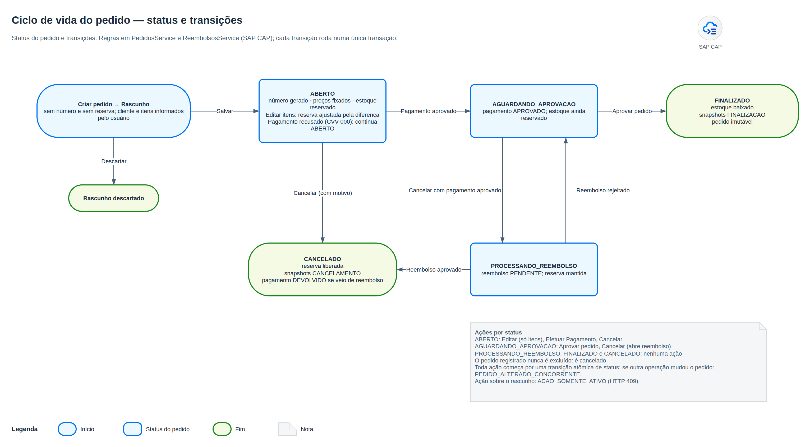</a>
</p>

<details>
<summary>Versão em Mermaid</summary>

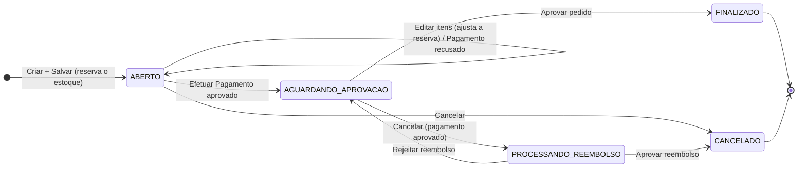

</details>

---

## Diagramas dos processos

Fluxogramas dos principais processos, em raias por responsável (usuário, serviço SAP CAP, banco de dados
e serviço externo), cada uma com sua faixa de cor e ícone SAP. Seguem a mesma legenda do projeto RAP:
início em pílula azul, etapas com borda azul, decisões em laranja, status do pedido em azul claro, fim
em pílula verde e erros (nada é gravado) em pílula vermelha; avisos que não bloqueiam ficam em laranja
tracejado e as tabelas gravadas, em cilindro. Todos estão em
[`docs/arquitetura-e-processos.drawio`](docs/arquitetura-e-processos.drawio) (uma página por processo).

### Registro do pedido

Do rascunho ao pedido `ABERTO`: validações, número, preços fixados e reserva do estoque.

<p align="center">
  <a href="assets/diagramas/diagrama-registro-pedido.png">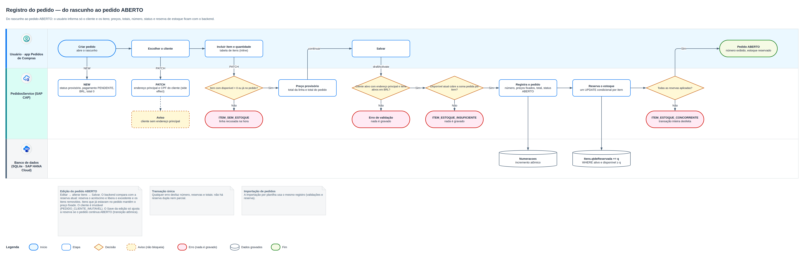</a>
</p>

### Efetuar Pagamento

Diálogo com máscara, validação dos dados do cartão, transição atômica de status e gravação só do
resultado seguro.

<p align="center">
  <a href="assets/diagramas/diagrama-efetuar-pagamento.png">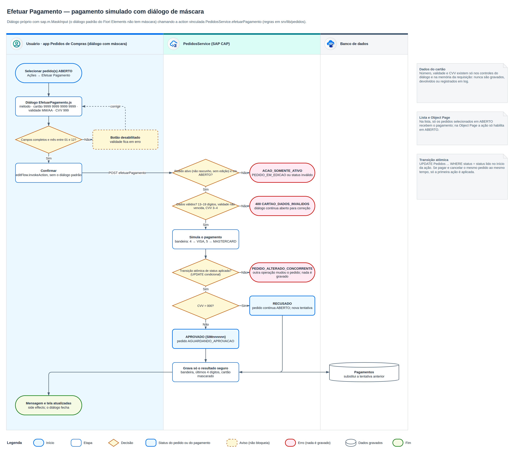</a>
</p>

### Aprovação do pedido

Transição atômica para `FINALIZADO`, baixa do estoque e snapshots.

<p align="center">
  <a href="assets/diagramas/diagrama-aprovacao-pedido.png">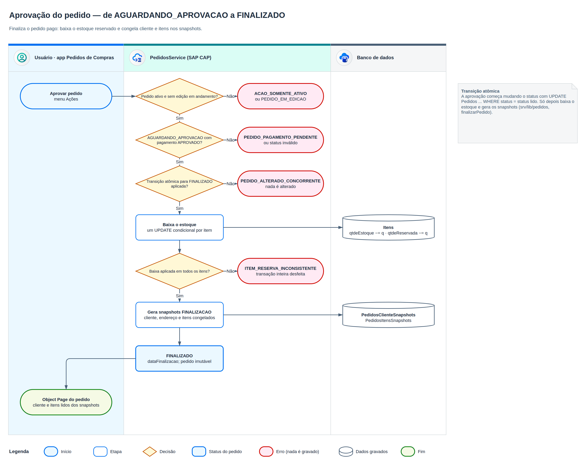</a>
</p>

### Cancelamento e reembolso

Cancelamento direto (sem pagamento aprovado) ou solicitação de reembolso decidida na Gestão de
Reembolsos.

<p align="center">
  <a href="assets/diagramas/diagrama-cancelamento-reembolso.png">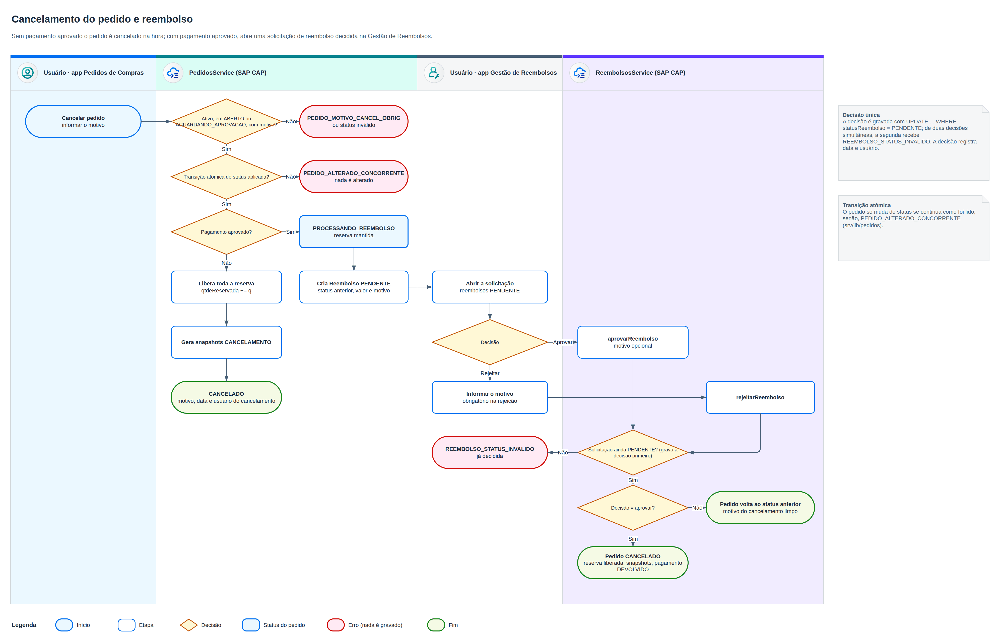</a>
</p>

### Endereço do cliente: consulta de CEP

Reaproveitamento de CEP já validado, consulta ao ViaCEP, CEP geral e validações do Save.

<p align="center">
  <a href="assets/diagramas/diagrama-endereco-cep.png">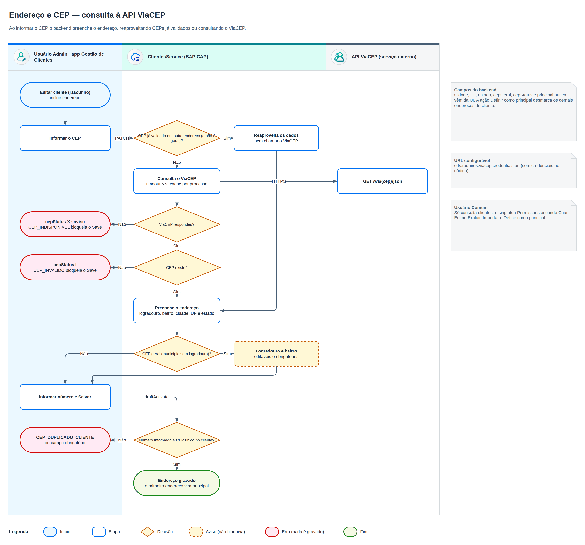</a>
</p>

### Importação por planilha

Validação de todas as linhas antes de gravar (tudo ou nada).

<p align="center">
  <a href="assets/diagramas/diagrama-importacao-planilha.png">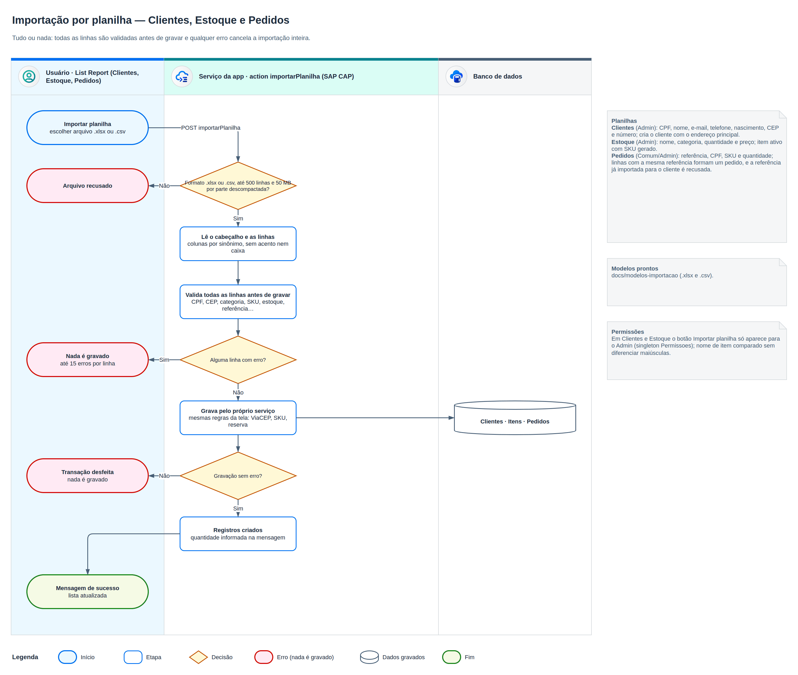</a>
</p>

---

## Estrutura do repositório

```text
.
├── nodejs-padrao/                     implementação em JavaScript (ESM)
│   ├── _i18n/messages.properties      mensagens de negócio
│   ├── app/
│   │   ├── common.cds                 rótulos, textos de CodeList, campos somente leitura
│   │   ├── services.cds               reúne as anotações das apps
│   │   ├── gestao-clientes/           Fiori Elements: annotations.cds + webapp/
│   │   ├── gestao-estoque/            Fiori Elements
│   │   ├── pedidos-compras/           Fiori Elements
│   │   ├── gestao-reembolsos/         Fiori Elements
│   │   ├── analise-pedidos/           SAPUI5 freestyle: Análise de Pedidos de Compras
│   │   ├── analise-clientes/          SAPUI5 freestyle: Análise de Clientes
│   │   ├── analise-estoque/           SAPUI5 freestyle: Análise de Itens do Estoque
│   │   ├── analise-reembolsos/        SAPUI5 freestyle: Análise de Pedidos de Reembolsos
│   │   ├── launchpad.html             sandbox do SAP Fiori launchpad
│   │   └── launchpad/                 configuração e inicialização do launchpad
│   ├── db/
│   │   ├── common.cds                 tipos e CodeLists
│   │   ├── schema.cds                 entidades
│   │   └── data/                      CodeLists e dados de demonstração (CSV)
│   ├── srv/
│   │   ├── *-service.cds              um serviço por aplicação + analitico-service.cds
│   │   ├── *-service.js               handlers dos serviços
│   │   ├── validacoes.cds             @mandatory / @assert
│   │   └── lib/                       regras de domínio reutilizáveis
│   ├── scripts/gerar-dados-demo.js    gerador dos CSVs de demonstração
│   ├── scripts/preparar-sqlite.js     cria o db.sqlite antes do primeiro watch
│   └── test/                          testes automatizados
│
├── nodejs-typescript/                 implementação em TypeScript (mesma estrutura)
│   ├── srv/*.ts, srv/lib/*.ts         handlers e regras tipados com #cds-models/*
│   ├── test/*.test.ts                 testes em TypeScript
│   ├── scripts/gerar-dados-demo.ts
│   ├── scripts/preparar-sqlite.ts
│   └── tsconfig.json, tsconfig.cdsbuild.json
│
├── assets/                            imagens do README e dos decks (capturas e diagramas)
│   ├── launchpad/                     launchpad local com os oito tiles
│   ├── pedidos/                       lista, Object Page, pagamento e fluxos do pedido e do cancelamento
│   ├── reembolsos/                    lista e fluxos de aprovação e rejeição
│   ├── clientes/                      lista e cadastro com endereço pelo CEP
│   ├── estoque/                       lista, novo item, importação por planilha e usuário comum
│   ├── analises/                      painéis, filtro, detalhes e Abrir gestão das quatro análises
│   └── diagramas/                     arquitetura e fluxogramas exportados do draw.io
│
├── docs/
│   ├── apresentacoes/                 seis decks .pptx, um por etapa, com uma seção por BO
│   ├── arquitetura-e-processos.drawio arquitetura e fluxogramas (draw.io)
│   ├── modelos-importacao/            modelos de planilha (.xlsx e .csv)
│   ├── especificacao-tecnica.md       especificação técnica (Markdown)
│   └── especificacao-tecnica.docx     especificação técnica (Word)
│
└── README.md
```

### Convenção de arquivos

| Arquivo | Conteúdo |
| --- | --- |
| `db/schema.cds`, `db/common.cds` | Entidades, tipos e CodeLists |
| `db/data/*.csv` | Dados iniciais (`<namespace>-<Entidade>.csv`) |
| `srv/*-service.cds` | Serviços e projeções expostas |
| `srv/*-service.js` / `.ts` | Handlers (`before`/`on`/`after`) |
| `srv/validacoes.cds` | Validações declarativas |
| `srv/lib/*` | Regras de domínio reutilizáveis |
| `app/<app>/annotations.cds` | Anotações de UI |
| `app/<app>/webapp/manifest.json` | Rotas, páginas, tabelas, ações customizadas, tile |
| `_i18n/messages.properties` | Mensagens de negócio |
| `test/*.test.js` / `.ts` | Testes automatizados |

---

## Pré-requisitos

- **Node.js 22** ou superior.
- `npm` (as apps usam *workspaces*: um único `npm install` por implementação).
- Opcional: `@sap/cds-dk` global (`cds` na linha de comando) — cada projeto já o tem como
  dependência de desenvolvimento.
- **VS Code** com *SAP CDS Language Support* e *SAP Fiori tools*, ou **SAP Business Application Studio**.
- Acesso à internet para o SAPUI5 (CDN `sapui5.hana.ondemand.com`) e para o ViaCEP.

---

## Instalação e execução

```sh
git clone https://github.com/AdrianoBispo/sap-cap-nodejs-pedidos-de-compras-app.git
cd sap-cap-nodejs-pedidos-de-compras-app/nodejs-padrao   # ou nodejs-typescript
npm install
npm run watch            # serviços + apps em http://localhost:4004
```

Abra `http://localhost:4004/launchpad.html` (launchpad com os oito tiles) ou a página inicial do
CAP, que lista serviços e apps.

O banco de desenvolvimento é um **SQLite em arquivo** (`db.sqlite`, fora do Git). Na primeira
execução, o `npm run watch` cria o arquivo com `cds deploy`, carregando os dados de `db/data`: 100
clientes, 100 itens e 100 pedidos em todos os status. Depois disso os dados, inclusive as fotos
enviadas, ficam gravados entre reinícios. Depois de mudar o modelo CDS ou os CSVs
(`npm run dados:demo` os regenera), recrie o banco com `npm run db:deploy`; isso apaga o que foi
gravado. Os testes usam sempre um SQLite em memória e não tocam no `db.sqlite`.

Para testar em **HTTPS** local (ex.: recursos do navegador que exigem contexto seguro), deixe o
`watch` rodando e, em outro terminal, execute `npm run https`: o `local-ssl-proxy` publica
`https://localhost:8443` apontando para a porta 4004 (certificado autoassinado).

### Usuários de desenvolvimento

Autenticação *mocked* do CAP:

| Usuário | Senha | Papel | Permissões |
| --- | --- | --- | --- |
| `admin` | `admin` | `Admin` | Tudo: clientes, estoque, pedidos, reembolsos, análises e importação |
| `comum` | `comum` | `Comum` | Consulta clientes e estoque; cria e opera pedidos (inclusive importação); decide reembolsos; análises |

### Scripts

| Script | JavaScript | TypeScript |
| --- | --- | --- |
| `npm run watch` | `cds watch` (cria o `db.sqlite` se ainda não existir) | `cds-tsx watch` (executa os `.ts` com `tsx`; cria o `db.sqlite` se ainda não existir) |
| `npm run db:deploy` | Recria o `db.sqlite` com o modelo e os CSVs | Recria o `db.sqlite` com o modelo e os CSVs |
| `npm test` | 74 testes (`node --test`), em SQLite em memória | `typer` + 76 testes (`node --import tsx --test`), em SQLite em memória |
| `npm run lint` | ESLint | ESLint + `typecheck` |
| `npm run typecheck` | — | `cds-typer` + `tsc --noEmit` |
| `npm run build` | — | `cds build --production` (JavaScript em `gen/srv`) |
| `npm run https` | Proxy HTTPS 8443 → 4004 | Proxy HTTPS 8443 → 4004 |
| `npm run dados:demo` | Regenera `db/data` | Regenera `db/data` |

---

## Front-end Fiori

Quatro apps **Fiori Elements OData V4** (List Report + Object Page), geradas com o **SAP Fiori tools**,
e quatro apps **SAPUI5 freestyle** de análise. Ficam em `app/` de cada implementação e são servidas pelo próprio CAP
via `cds-plugin-ui5`. A UI é orientada a anotações: colunas, filtros, seções, ações, criticidade e
side effects vêm de `app/<app>/annotations.cds` e `app/common.cds`.

| App | Caminho | Páginas | Tile (objeto semântico) |
| --- | --- | --- | --- |
| Gestão de Clientes | `/gestaoclientes/index.html` | Cliente → Endereço | `Cliente-manage` |
| Gestão de Estoque | `/gestaoestoque/index.html` | Item | `ItemEstoque-manage` |
| Pedidos de Compras | `/pedidoscompras/index.html` | Pedido → Item do pedido / Item no encerramento | `PedidoCompra-manage` |
| Gestão de Reembolsos | `/gestaoreembolsos/index.html` | Reembolso | `Reembolso-manage` |
| Análise de Pedidos de Compras | `/analisepedidos/index.html` | Painel → Detalhe da análise | `AnalisePedidos-display` |
| Análise de Clientes | `/analiseclientes/index.html` | Painel → Detalhe da análise | `AnaliseClientes-display` |
| Análise de Itens do Estoque | `/analiseestoque/index.html` | Painel → Detalhe da análise | `AnaliseEstoque-display` |
| Análise de Pedidos de Reembolsos | `/analisereembolsos/index.html` | Painel → Detalhe da análise | `AnaliseReembolsos-display` |

- **Importar planilha**: ação customizada no List Report de Clientes, Estoque e Pedidos
  (`webapp/ext/ImportarPlanilha.js`), com diálogo de escolha de arquivo que chama a action
  `importarPlanilha` do serviço.
- **Itens do pedido** são criados na própria tabela (*inline*), só no rascunho.
- **Efetuar Pagamento** (List Report e Object Page do pedido) abre um diálogo próprio
  (`webapp/ext/EfetuarPagamento.js`) com `sap.m.MaskInput` no cartão, na validade e no CVV — o diálogo
  padrão de parâmetros do Fiori Elements não tem máscara de digitação. O botão só habilita com todos os
  campos completos e mês de validade entre 01 e 12; a chamada é a mesma action vinculada, pelo
  `editFlow`, e o backend continua validando tudo. A ação fica no menu *Ações* junto de *Aprovar
  pedido* e *Cancelar pedido*.
- **Navegação entre apps** (no launchpad local): os campos abaixo viram links que abrem a Object
  Page do registro na app de destino, que o localiza pela chave semântica (`cpf`, `sku`,
  `numeroPedido`) recebida no contexto da navegação.

  | Origem | Campos com link | Destino |
  | --- | --- | --- |
  | Pedidos | Cliente, CPF | Gestão de Clientes (`Cliente-manage`, `cpfCliente` → `cpf`) |
  | Itens do pedido | Item, SKU | Gestão de Estoque (`ItemEstoque-manage`, `skuItem` → `sku`) |
  | Pedidos | *Solicitação de reembolso* (link direto, só quando o pedido tem reembolso) | Gestão de Reembolsos (`Reembolso-manage`, `numeroPedido`) |
  | Pedidos (encerrado) | Cliente, CPF do snapshot | Gestão de Clientes (`Cliente-manage`) |
  | Item no encerramento | Item, SKU do snapshot | Gestão de Estoque (`ItemEstoque-manage`) |
  | Reembolsos | Pedido (link direto, `DataFieldWithIntentBasedNavigation`) | Pedidos de Compras (`PedidoCompra-manage`) |
  | Reembolsos | Cliente, CPF | Gestão de Clientes (`Cliente-manage`) |
  | Apps de análise | Botão *Abrir gestão* | App de gestão do domínio |

  O launchpad liga a resolução de intents no cliente (`ClientSideTargetResolution`); sem ela o Fiori
  Elements não recebe os objetos semânticos disponíveis e esconde os links.
- **Object Page do item no encerramento** (snapshot do pedido finalizado ou cancelado): mostra nome,
  SKU, descrição, categoria, quantidade, preço, total e data do congelamento.
- **Validação**: manifests na versão 2.0.0, UI5 linter sem apontamentos; telas conferidas no navegador.

---

## Testes

### Cenários de teste

Pelas apps (com `npm run watch`) ou chamando os serviços OData:

| Cenário | Como testar |
| --- | --- |
| Pagamento aprovado | Cartão `4111 1111 1111 1111` (VISA), validade futura (ex.: `12/30`), CVV `123` |
| Pagamento recusado | Mesmo cartão com CVV `000` (pedido permanece `ABERTO`; pagamento `RECUSADO`) |
| Mastercard | Cartão iniciado por `5` (ex.: `5555 5555 5555 4444`) |
| Dados de cartão inválidos | Validade vencida ou CVV com 2 dígitos → erro (não é recusa) |
| Item sem estoque | Incluir no rascunho um item com disponível zerado → bloqueado na hora (`ITEM_SEM_ESTOQUE`) |
| Reserva no Save | Salvar um rascunho válido → pedido `ABERTO` e `qtdeReservada` do item aumenta; estoque insuficiente → bloqueado |
| Edição de itens | Em pedido `ABERTO`: *Editar* → alterar quantidade, incluir ou remover item → *Salvar* ajusta a reserva só pela diferença |
| Campos somente leitura | No pedido, só *Cliente* (na criação) e os itens são editáveis; dados do cliente e pagamento são somente leitura |
| Concorrência | Editar um item no Estoque e, no meio tempo, registrar um pedido com ele: ao salvar o item a reserva feita pelo pedido é preservada |
| Exclusão de cliente | Excluir cliente com pedido → bloqueado (`CLIENTE_COM_PEDIDO`) |
| CEP duplicado | Dois endereços com o mesmo CEP no **mesmo** cliente → bloqueado (`CEP_DUPLICADO_CLIENTE`) |
| Reembolso | Pagar e cancelar um pedido → `PROCESSANDO_REEMBOLSO`; na Gestão de Reembolsos, aprovar (pedido `CANCELADO`, pagamento `DEVOLVIDO`) ou rejeitar (motivo obrigatório; pedido volta ao status anterior) |
| Perfil comum | Entrar como `comum`: Clientes e Estoque ficam somente para consulta |

Fluxo do pedido: **Criar** (rascunho, informando o cliente e os itens) → **Salvar** (registra e
reserva o estoque) → **Efetuar Pagamento** → **Aprovar pedido** (ou **Cancelar pedido** com motivo).

### Testes automatizados

```sh
npm test         # em nodejs-padrao ou nodejs-typescript
```

Os testes sobem o servidor com `cds.test`, usam um **ViaCEP falso local** (sem rede externa) e um
gerador mínimo de `.xlsx`. **São permanentes**: devem ser mantidos e ajustados junto com as regras
de negócio. São 74 testes em JavaScript e 76 em TypeScript, todos passando:

| Arquivo | Cobre |
| --- | --- |
| `unidade.test` | CPF, e-mail, telefone, imagens, status de estoque, SKU, pagamento simulado, leitor XLSX/CSV (inclusive o limite do conteúdo descompactado) |
| `clientes.test` | Rascunho, ViaCEP, CEP geral, CEP único, endereço principal, CPF, autorização (inclusive `Permissoes`), exclusão, foto (formato e gravação depois do Save) |
| `estoque.test` | SKU, disponibilidade e status, concorrência com edição, inativação, exclusão, `Permissoes` e foto gravada depois do Save |
| `pedidos.test` | Registro com reserva, edição pela diferença, pagamento, aprovação, cancelamento (inclusive ações recusadas no rascunho e ações com o pedido alterado por outra operação), reembolso, campos somente leitura |
| `reembolsos.test` | Aprovar, rejeitar (motivo obrigatório), decisão única |
| `importacao.test` | Clientes, estoque e pedidos (tudo ou nada), nomes e pedidos já importados recusados e os modelos de `docs/modelos-importacao` |
| `analitico.test` | Agregações `$apply` dos quatro domínios |

Os testes rodam sem o `cds-plugin-ui5` (`CDS_PLUGIN_UI5_ACTIVE=false`), porque exercitam só o backend.

As apps de análise têm ainda testes **QUnit** do catálogo de cenários e da montagem das consultas
`$apply` (`webapp/test/unit`), executados no navegador com `npm run watch` em
`/<app>/test/testsuite.qunit.html` (ex.: `/analisepedidos/test/testsuite.qunit.html`).

---

## Pedido: o que o usuário informa

No pedido de compras o usuário informa **somente o Cliente** (na criação) e os **itens**; todo o
resto é preenchido automaticamente:

| Campo | Origem |
| --- | --- |
| CPF, e-mail, telefone, gênero, data de nascimento | Associação `cliente` (somente leitura, `@Core.Computed`) |
| Endereço de entrega | Endereço principal do cliente, definido pelo backend ao escolher o cliente |
| Número, status do pedido e do pagamento, total | Backend (registro, ações e recálculo dos itens) |
| Preço unitário e total de cada item | Backend: preço do estoque no rascunho; preço fixado no registro |
| Pagamento (método, status, bandeira, cartão mascarado, autorização, mensagem, data) | Só a ação *Efetuar Pagamento* (`Pagamentos` é `@readonly` no serviço) |
| Observação | Somente leitura na tela; preenchida pela importação por planilha |
| Referência de importação | Coluna Pedido da planilha; gravada só pela importação (impede reimportar o mesmo pedido) |

Depois do registro o cliente fica somente leitura (`Common.FieldControl` por expressão) e, no
servidor, a troca é recusada (`PEDIDO_CLIENTE_IMUTAVEL`). Campos mantidos pelo backend que chegam
num PATCH do rascunho são descartados.

---

## Endereço do cliente: consulta de CEP

A consulta do CEP é feita inteiramente no backend. Na app, o **CEP** é um campo padrão do Fiori
Elements, com value help dos CEPs já cadastrados.

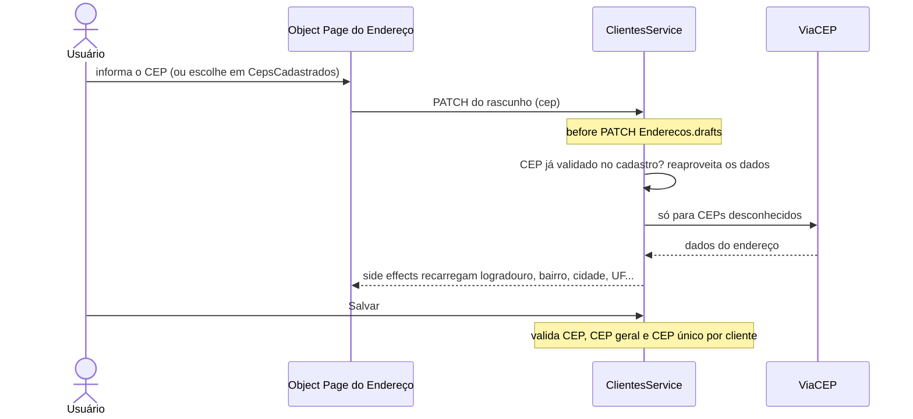

1. A entidade `CepsCadastrados` (value help) sugere os CEPs já validados (um por CEP, sem CEP geral).
2. No PATCH do rascunho, `preencherEnderecoPorCep` grava logradouro, bairro, cidade, UF, estado,
   `cepGeral` e `cepStatus` (`V` validado, `I` inválido, `X` indisponível). ViaCEP fora do ar gera
   um aviso, e o Save fica bloqueado até a consulta funcionar.
3. Para **CEP geral de município** (o ViaCEP não devolve logradouro/bairro), esses dois campos ficam
   editáveis e obrigatórios (`controleCampoCep` = 7); nos demais casos são somente leitura.
4. O side effect `Common.SideEffects#Cep` faz a UI recarregar os campos logo após o CEP.
5. A URL do ViaCEP vem de `cds.requires.viacep.credentials.url`; os testes a trocam por um servidor
   falso local.

---

## Endereço principal e CEP único

- **Primeiro endereço vira principal** automaticamente; a ação **Definir como principal** (no
  rascunho ou no cliente ativo) desmarca os demais.
- **CEP único por cliente, não global**: o mesmo cliente não pode ter dois endereços com o mesmo CEP
  (validação no Save + restrição `UNIQUE (cliente_ID, cep)` no banco), mas clientes diferentes podem
  compartilhar um CEP.
- **CEP pode ser alterado** depois de gravado: a chave do endereço é só o `ID`.

---

## Reembolso de pedidos

Quando **Cancelar pedido** é acionado sobre um pedido cujo pagamento está `APROVADO`, o cancelamento
não é direto: o backend abre um processo de reembolso.

1. `cancelarPedido` cria a solicitação em `Reembolsos` (status `PENDENTE`, guardando o status anterior
   do pedido) e move o pedido para `PROCESSANDO_REEMBOLSO`, mantendo a reserva de estoque.
2. **Aprovar reembolso** (app Gestão de Reembolsos): libera a reserva, gera os snapshots, cancela o
   pedido com `dataCancelamento`, marca o pagamento como `DEVOLVIDO` e o reembolso como `APROVADO`,
   na mesma transação.
3. **Rejeitar reembolso** (motivo obrigatório): o pedido volta ao status anterior, o motivo do
   cancelamento é limpo e o reembolso fica `REJEITADO`.

As duas ações só ficam disponíveis com o reembolso `PENDENTE` (`Core.OperationAvailable`).

---

## Importação em massa por planilha

As apps **Gestão de Clientes**, **Gestão de Estoque** e **Pedidos de Compras** têm o botão
**Importar planilha** na lista. Ele abre um diálogo para escolher um arquivo `.xlsx` ou `.csv` e cria
os registros de uma vez. Modelos prontos estão em [`docs/modelos-importacao/`](docs/modelos-importacao).

| App | Linha da planilha | Colunas (obrigatórias em **negrito**) |
| --- | --- | --- |
| Clientes | um cliente com o endereço principal | **CPF**, **Nome**, **E-mail**, **Telefone**, Gênero, **Data de nascimento**, **CEP**, **Número**, Complemento |
| Estoque | um item | **Nome**, Descrição, **Categoria**, **Quantidade em estoque**, **Preço unitário**, Moeda (padrão `BRL`) |
| Pedidos | um item de um pedido | **Pedido** (referência que agrupa as linhas), **CPF**, **SKU**, **Quantidade**, Observação |

- A primeira linha não vazia é o cabeçalho; nomes de coluna sem diferença de acento, caixa ou
  pontuação, e com sinônimos. CSV com `;`, `,` ou tabulação, UTF-8 (com ou sem BOM) ou Windows-1252.
- XLSX lido sem bibliotecas externas (ZIP + XML): aceita textos compartilhados e *inline* (inclusive
  arquivos do LibreOffice). `.xls` antigo não é aceito. Máximo de **500 linhas** e de 50 MB por parte
  descompactada do arquivo.
- **Tudo ou nada**: todas as linhas são validadas antes de gravar; qualquer erro cancela a importação
  e lista o motivo por linha (no máximo 15, mais o total omitido).
- A criação passa pelo próprio serviço, então valem as mesmas regras da tela (CPF, ViaCEP, SKU,
  número do pedido, reserva de estoque).
- **Sem duplicidade**: clientes (CPF) e itens (nome, sem diferenciar maiúsculas de minúsculas) já
  cadastrados são recusados. Nos pedidos, a
  coluna **Pedido** é gravada como *Referência de importação* (somente leitura, até 40 caracteres) e
  funciona como chave de idempotência: a mesma referência para o mesmo cliente é recusada enquanto
  houver pedido não cancelado com ela (`Linha 2: o pedido P001 do cliente 100.003.571-97 já foi
  importado (pedido 0000000101).`). Reenviar a mesma planilha não cria pedidos repetidos; outro
  cliente pode usar a mesma referência, e um pedido cancelado a libera.
- Clientes e Estoque exigem o papel `Admin`; Pedidos, `Comum` ou `Admin`.

---

## Rascunhos (draft)

Clientes (com endereços), Itens e Pedidos (com itens, pagamento e snapshots) usam o rascunho do CAP
(`@odata.draft.enabled`). As tabelas de rascunho são geradas automaticamente
(`<Serviço>_<Entidade>_drafts`), sem tabelas a manter manualmente. Eventos usados:

| Evento | Onde | Uso |
| --- | --- | --- |
| `NEW` | `*.drafts` | Valores iniciais (status, moeda, cliente ativo, score, endereço principal) |
| `PATCH` | `*.drafts` | Endereço pelo CEP, endereço do pedido pelo cliente, preço e total dos itens, descarte de campos do backend |
| `EDIT` | entidade ativa | Pedido só é editado em `ABERTO` |
| `CREATE` / `UPDATE` | entidade ativa (Salvar) | Validações, SKU, registro do pedido e reserva pela diferença |
| `DISCARD` | `ItensPedido.drafts` | Recalcula o total do rascunho ao excluir uma linha |

---

## Análises

Camada analítica **somente leitura**: `AnaliticoService` expõe `PedidosAnalise`, `ClientesAnalise`,
`ItensAnalise` e `ReembolsosAnalise`, com dimensões e medidas (`@Aggregation.default`, expostas como
*custom aggregates*), o que permite `$apply=groupby/aggregate` no servidor.

O front-end são quatro apps **freestyle**, uma por domínio, cada uma com barra de filtros,
indicadores, 5 gráficos e uma página de detalhe por análise
(gráfico ampliado e tabela), num total de 20 análises:

| App | Entidade | Indicadores | Análises |
| --- | --- | --- | --- |
| Análise de Pedidos de Compras (`analise-pedidos`) | `PedidosAnalise` | Valor total, pedidos, ticket médio | Valor por status; pedidos por mês; valor por UF; pedidos por status do pagamento; ticket médio por status |
| Análise de Clientes (`analise-clientes`) | `ClientesAnalise` | Clientes, score médio | Por gênero; por UF; por faixa de score; cadastros por mês; score médio por UF |
| Análise de Itens do Estoque (`analise-estoque`) | `ItensAnalise` | Itens, em estoque, reservada, disponível, valor em estoque | Estoque por categoria; itens por situação; valor por categoria; mais reservados (top 10); itens por categoria |
| Análise de Pedidos de Reembolsos (`analise-reembolsos`) | `ReembolsosAnalise` | Reembolsos, valor | Valor por status; quantidade por status; valor por mês; valor por UF; por motivo da solicitação |

As quatro compartilham a mesma estrutura (`model/Scenarios.js` com as medidas, dimensões e cenários
do domínio, `model/AnalyticsQuery.js` para o `$apply`, `control/AnalysisChart.js` e `FilterBar.js`) e
o botão *Abrir gestão* navega para a app de gestão do domínio.

---

## Limitações conhecidas e pendências

- **SAP HANA Cloud**: o `@cap-js/hana` e o perfil `[production]` já estão configurados, e o
  `cds build --production` gera os artefatos HDI. O modelo usa funções portáveis do CAP e colunas
  geradas suportadas pelo HANA, mas a aplicação ainda não foi implantada nem executada sobre o HANA
  Cloud; faltam `cds add xsuaa,mta` e o deploy.
- **Autenticação de produção** (XSUAA/IAS) e descritor MTA ainda não configurados; em desenvolvimento
  a autenticação é *mocked*. A arquitetura alvo está em
  [Arquitetura na SAP BTP (implantação)](#arquitetura-na-sap-btp-implantação).
- **Object Page**: as seções são carregadas sob demanda; ao abrir um pedido a página pode começar
  rolada para *Dados do Pedido* — role para cima ou use a barra de seções para ver *Dados do Cliente*.

---

## Histórico de versões

| Versão | Mudanças |
| --- | --- |
| v1.9 | Foto do cliente e do item gravada vazia no upload: dois handlers liam o mesmo stream ao mesmo tempo e um deles gravava um conteúdo vazio; agora a leitura de cada stream é feita uma vez só (`lerConteudo` em `srv/lib/requisicao`). Banco: SQLite em arquivo (`db.sqlite`) no perfil `[development]`, criado no primeiro `npm run watch` e mantido entre reinícios (`npm run db:deploy` recria); `@cap-js/hana` nas dependências e perfil `[production]` com o SAP HANA Cloud; testes em SQLite em memória; 74 testes em JavaScript e 76 em TypeScript; especificação técnica 2.5 |
| v1.8 | Diagramas no draw.io com as formas oficiais da SAP (`docs/arquitetura-e-processos.drawio`): arquitetura, arquitetura alvo na SAP BTP (SAP HANA Cloud, XSUAA e Cloud Foundry), ciclo de vida do pedido e fluxogramas do registro, pagamento, aprovação, cancelamento e reembolso, consulta de CEP e importação por planilha, exportados como imagens em `docs/assets` e exibidos neste README |
| v1.7 | Concorrência nas ações do pedido: pagar, aprovar e cancelar o pedido e decidir o reembolso começam por um `UPDATE` condicional ao status lido (`transicionarPedido` em `srv/lib/pedidos`), que também bloqueia o pedido até o fim da transação; a ação que perde a corrida é recusada com `PEDIDO_ALTERADO_CONCORRENTE` (ou `REEMBOLSO_STATUS_INVALIDO`) sem liberar a reserva de novo, baixar estoque ou gravar pagamento (antes, um segundo cancelamento simultâneo liberava a reserva de outros pedidos); o Save da edição do pedido também confere o status; pagar e aprovar passam para `srv/lib/pedidos` (`efetuarPagamento` e `finalizarPedido`); `.vscode` de cada implementação igual ao gerado pelo `cds init` (como no SAP Business Application Studio): depuração *cds serve* e tarefa *cds watch*; 72 testes em JavaScript e 74 em TypeScript; especificação técnica 2.4 |
| v1.6 | Revisão do código: comentários explicam só a aplicação CAP e todas as funções foram documentadas (JSDoc/TSDoc); READMEs e especificação técnica 2.3 (.md e .docx) sem as comparações com o projeto RAP, mantido só o link para o repositório dele; singleton `Permissoes` esconde Criar, Editar, Excluir, Importar e *Definir como principal* do usuário só de consulta em Clientes e Estoque; ações do pedido chamadas no rascunho devolvem 409 (`ACAO_SOMENTE_ATIVO`) em vez de 501; importação de estoque recusa nome já cadastrado sem diferenciar maiúsculas; leitor de `.xlsx` limita o conteúdo descompactado a 50 MB; `package-lock.json` da versão TypeScript atualizado (`@sap/cds-dk` 10.1.2); 71 testes em JavaScript e 73 em TypeScript |
| v1.5 | Análises divididas em quatro apps (Análise de Pedidos de Compras, de Clientes, de Itens do Estoque e de Pedidos de Reembolsos), com tiles próprios no launchpad e testes QUnit corrigidos; máscara de digitação no diálogo *Efetuar Pagamento*; navegações das Object Pages completadas (pedido → reembolso, histórico do cliente e dos itens → apps de origem, Object Page do item no encerramento); especificação técnica 2.2 |
| v1.4 | Importação de pedidos sem duplicidade: a coluna Pedido vira a *Referência de importação* do pedido, e a mesma referência para o mesmo cliente é recusada enquanto houver pedido não cancelado com ela; 68 testes por versão; especificação técnica 2.1 |
| v1.3 | Navegação entre aplicações: no pedido, Cliente/CPF → Gestão de Clientes e Item/SKU → Gestão de Estoque; no reembolso, Pedido → Pedidos de Compras e Cliente/CPF → Gestão de Clientes; `skuItem` em `ItensPedido` e CPF sem formatação em `Reembolsos` para o contexto da navegação |
| v1.2 | Correção no pedido: só o cliente (na criação) e os itens são informados; dados do cliente lidos pela associação e somente leitura (antes apareciam editáveis e obrigatórios e ficavam vazios no rascunho); pagamento e snapshots somente leitura, gravados só pelas ações; observação somente leitura na tela; testes de regressão (66 por versão); README principal reestruturado |
| v1.1 | Versão TypeScript (`nodejs-typescript`, `cds-typer`, `tsx`); especificação técnica 2.0 (.md e .docx); proxy HTTPS local (`npm run https`) |
| v1.0 | Versão JavaScript (`nodejs-padrao`): modelo, serviços, regras de negócio, cinco apps SAPUI5, launchpad local, importação por planilha, camada analítica, dados de demonstração e suíte de testes |

---

## Documentação

- [Especificação técnica](docs/especificacao-tecnica.md) (Markdown) e
  [versão Word](docs/especificacao-tecnica.docx).
- [README da implementação JavaScript](nodejs-padrao/README.md).
- [README da implementação TypeScript](nodejs-typescript/README.md).
- [Modelos de importação](docs/modelos-importacao).
- [Arquitetura e fluxogramas dos processos](docs/arquitetura-e-processos.drawio) (draw.io, formas oficiais da SAP);
  as imagens estão em [Arquitetura](#arquitetura) e [Diagramas dos processos](#diagramas-dos-processos).
- Aplicação em SAP RAP / ABAP Cloud: [sap-abap-rap-pedidos-de-compras-app](https://github.com/AdrianoBispo/sap-abap-rap-pedidos-de-compras-app).

---

## Autor

Desenvolvido por **Adriano Bispo**.

[](https://github.com/AdrianoBispo)
