# Especificação Técnica — Sistema de Pedidos de Compras (SAP CAP + SAP Fiori)

> **Versão 2.6 — outubro de 2026.** Descreve o sistema **como implementado** nas duas versões do
> repositório, [`nodejs-padrao`](../nodejs-padrao) (JavaScript) e
> [`nodejs-typescript`](../nodejs-typescript) (TypeScript), que compartilham modelo CDS, serviços,
> apps SAPUI5 e testes. Os diagramas editáveis estão em
> [`arquitetura-e-processos.drawio`](arquitetura-e-processos.drawio).

---

## 1. Visão Geral

Aplicação full stack de pedidos de compras com foco educacional, construída no SAP Cloud Application
Programming Model (CAP). A versão em SAP RAP / ABAP Cloud está em
[sap-abap-rap-pedidos-de-compras-app](https://github.com/AdrianoBispo/sap-abap-rap-pedidos-de-compras-app).

**Escopo**

- Clientes e endereços, com preenchimento e validação do CEP no ViaCEP.
- Estoque: itens com SKU automático, quantidade total, reservada e disponível.
- Ciclo do pedido: rascunho, registro com reserva, pagamento simulado, aprovação e cancelamento.
- Reembolso de pedidos pagos que são cancelados.
- Snapshots imutáveis do cliente e dos itens no encerramento do pedido.
- Importação por planilha (`.xlsx`/`.csv`) de clientes, itens e pedidos.
- 20 análises em quatro apps (pedidos, clientes, estoque e reembolsos).
- Papéis `Admin` e `Comum`, controle de concorrência no estoque e testes automatizados.

**Fora do escopo:** frete, logística e rastreamento; gateway de pagamento real; histórico de
tentativas de pagamento; auditoria e monitoramento produtivo.


*Launchpad local: quatro apps de gestão e quatro de análise.*

### 1.1 Stack

| Camada | Tecnologia |
|---|---|
| Backend | SAP CAP 10 (`@sap/cds` 10), Node.js 22+, ESM |
| Linguagem | JavaScript ou TypeScript 6.0 `strict` com cds-typer |
| Banco | SQLite em arquivo (`db.sqlite`) no desenvolvimento; SAP HANA Cloud (`@cap-js/hana`) configurado para produção |
| Protocolo | OData V4 com rascunho (draft) e `$apply` |
| Frontend | SAPUI5 1.148: 4 apps Fiori Elements V4 + 4 apps freestyle de análise, servidas pelo `cds-plugin-ui5` |
| Integração | ViaCEP via `fetch` (URL em `cds.requires.viacep`) |
| Segurança | Autenticação *mocked* (`admin`/`comum`); XSUAA na implantação |
| Qualidade | `node:test` + `@cap-js/cds-test` (74 testes em JS, 76 em TS), ESLint 10, QUnit nas análises |

### 1.2 Arquitetura


*Launchpad e apps SAPUI5 consomem um serviço OData por aplicação; as regras de domínio ficam em
`srv/lib` e rodam na transação da requisição.*

---

## 2. Perfis e Segurança

| Recurso | `Comum` | `Admin` |
|---|---|---|
| Clientes, endereços e itens de estoque | Consultar | Consultar, criar, editar, inativar, excluir, importar |
| Pedidos | Criar, editar, pagar, aprovar, cancelar, importar | Idem |
| Reembolsos | Consultar, aprovar, rejeitar | Idem |
| Análises | Consultar | Consultar |

- Autorização declarativa: `@requires: 'authenticated-user'` em todos os serviços; `@restrict` dá
  `READ` ao `Comum` e `*` ao `Admin` em clientes e estoque; `importarPlanilha` de clientes e estoque
  exige `Admin`.
- Usuários de desenvolvimento (HTTP Basic, perfil `[development]` do `package.json`): `admin`/`admin`
  e `comum`/`comum`.
- Como os papéis não chegam às anotações de UI, `ClientesService` e `EstoqueService` expõem o
  singleton `Permissoes` (`somenteLeitura`), usado por `UI.CreateHidden`, `UI.UpdateHidden` e
  `UI.DeleteHidden`. O `Comum` só vê as opções de consulta; o backend continua barrando alterações.
- Dados de cartão nunca são gravados, retornados ou registrados em log.
- Campos controlados pelo backend (status, totais, número, reserva, score, endereço do pedido)
  ignoram valores enviados pela UI.
- Pedidos encerrados e snapshots são imutáveis; o pedido registrado é cancelado, nunca excluído.
- Fotos validadas por MIME, extensão e assinatura binária (JPEG, PNG ou WEBP).

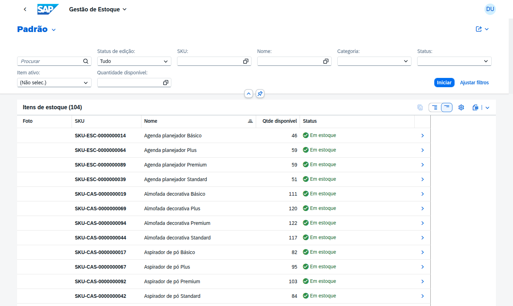

*Usuário `Comum` na Gestão de Estoque: sem Criar, Excluir ou Importar planilha.*

---

## 3. Modelo de Dados

Arquivos `db/common.cds` (tipos e CodeLists) e `db/schema.cds` (entidades), namespace
`pedidoscompras`. Todas as entidades usam `cuid` e `managed`. Convenções: entidades no plural e em
português, campos em `camelCase`, códigos de status em `UPPER_SNAKE_CASE`.

| Entidade | Finalidade | Campos e regras principais |
|---|---|---|
| `Clientes` | Cadastro | `cpf` (único, dígitos verificadores), `nome`, `email` (minúsculas), `telefone` (10–11 dígitos), `dataNascimento` (não futura), `genero`, `clienteAtivo`, `scoreCliente` (0–100, sorteado), `fotoCliente`; composição `enderecos` |
| `Enderecos` | Endereços do cliente | `cep` (único por cliente), `numero`, `complemento`, `logradouro`, `bairro`, `cidade`, `uf`, `estado`, `cepGeral`, `cepStatus` (`V`/`I`/`X`), `principal` (um por cliente) |
| `Itens` | Estoque | `sku` (gerado, único), `nome`, `descricao`, `categoria`, `qtdeEstoque`, `qtdeReservada`, `qtdeDisponivel` e `statusEstoque` (colunas geradas), `precoUnitario`, `currency` (BRL), `itemAtivo`, `fotoItem` |
| `Pedidos` | Cabeçalho do pedido | `numeroPedido` (10 dígitos), `cliente` (imutável após o registro), `endereco`, `statusPedido`, `statusPagamento`, `valorTotal`, `observacao`, `referenciaImportacao`, dados de finalização e de cancelamento |
| `ItensPedido` | Linhas do pedido | `item` (ativo), `qtdeItemPedido` (> 0), `precoUnitarioSnapshot` (fixado no registro), `valorTotal` |
| `Pagamentos` | Última tentativa | `metodoPagamento`, `statusPagamento`, `bandeiraCartao`, `ultimos4DigitosCartao`, `cartaoMascarado`, `codigoAutorizacao`, `mensagemPagamento`, `dataPagamento` |
| `PedidosClienteSnapshots` | Cliente e endereço congelados | Cópia dos dados do cliente e do endereço, com `motivoSnapshot` (`FINALIZACAO`/`CANCELAMENTO`) |
| `PedidosItensSnapshots` | Itens congelados | SKU, nome, descrição, categoria, quantidade, preço e total de cada linha |
| `Reembolsos` | Solicitações de reembolso | `pedido`, `statusReembolso`, `statusPedidoAnterior`, `valorReembolso`, motivo/data/usuário da solicitação e da decisão |
| `Numeracoes` | Sequenciais | `objeto` (`PEDIDO`, `SKU`) e `ultimoNumero`, incrementado por `UPDATE` atômico |

**CodeLists** (aspect `CodeListOrdenada`, com `ordem` e `criticality` para colorir os status):

| CodeList | Códigos |
|---|---|
| `Generos` | `MASCULINO`, `FEMININO`, `NAO_BINARIO`, `OUTRO`, `NAO_INFORMADO` |
| `Categorias` | `ELETRONICOS`, `INFORMATICA`, `ESCRITORIO`, `CASA`, `VESTUARIO`, `ALIMENTOS`, `OUTROS` |
| `StatusEstoque` | `SEM_ESTOQUE` (≤ 0), `ACABANDO` (1–10), `EM_ESTOQUE` (≥ 11) |
| `StatusPedido` | `ABERTO`, `AGUARDANDO_APROVACAO`, `PROCESSANDO_REEMBOLSO`, `CANCELADO`, `FINALIZADO` |
| `StatusPagamento` | `PENDENTE`, `APROVADO`, `RECUSADO`, `DEVOLVIDO` |
| `StatusReembolso` | `PENDENTE`, `APROVADO`, `REJEITADO` |
| `MetodosPagamento` | `CARTAO_CREDITO`, `CARTAO_DEBITO` |

**Validações.** Obrigatoriedade, formato e faixas (e-mail, telefone, nascimento, preço, estoque,
quantidade) são declarativas em `srv/validacoes.cds` (`@mandatory`, `@assert.format`, `@assert`) e
aparecem já no rascunho. Regras que dependem de algoritmo ou de outros registros (CPF, unicidade,
ViaCEP, estoque) ficam nos handlers.

**Cálculos** (sempre no backend):

```text
ItensPedido.valorTotal = arredondar(qtdeItemPedido × precoUnitarioSnapshot, 2)
Pedidos.valorTotal     = arredondar(Σ ItensPedido.valorTotal, 2)
Itens.qtdeDisponivel   = qtdeEstoque − qtdeReservada   (coluna gerada)
```

---

## 4. Serviços OData

Todos em OData V4, em `/odata/v4/<caminho>`, um por aplicação.

| Serviço | Caminho | Entidades principais | Actions |
|---|---|---|---|
| `ClientesService` | `clientes` | `Clientes` e `Enderecos` (rascunho), `CepsCadastrados`, `Permissoes` | `definirEnderecoPrincipal`, `importarPlanilha` |
| `EstoqueService` | `estoque` | `Itens` (rascunho), `Categorias`, `Permissoes` | `importarPlanilha` |
| `PedidosService` | `pedidos` | `Pedidos` e `ItensPedido` (rascunho), `ClientesAtivos`, `ItensAtivos` | `efetuarPagamento`, `aprovarPedido`, `cancelarPedido`, `importarPlanilha` |
| `ReembolsosService` | `reembolsos` | `Reembolsos` (somente leitura) | `aprovarReembolso`, `rejeitarReembolso` |
| `AnaliticoService` | `analitico` | `PedidosAnalise`, `ClientesAnalise`, `ItensAnalise`, `ReembolsosAnalise` | — |

```cds
// PedidosService (vinculadas a Pedidos)
action efetuarPagamento(metodoPagamento : String(20), numeroCartao : String(19),
                        validade : String(5), cvv : String(4)) returns Pedidos;
action aprovarPedido() returns Pedidos;
action cancelarPedido(motivoCancelamento : String(500)) returns Pedidos;

// ReembolsosService (vinculadas a Reembolsos)
action aprovarReembolso(motivoDecisao : String(500)) returns Reembolsos;
action rejeitarReembolso(motivoDecisao : String(500)) returns Reembolsos;   // motivo obrigatório

// ClientesService, EstoqueService e PedidosService
action importarPlanilha(arquivo : LargeBinary, nomeArquivo : String(255)) returns ResultadoImportacao;
```

As actions têm `@Core.OperationAvailable` (botão ativo só no status permitido) e
`@Common.SideEffects` (a tela recarrega após a execução). Reserva, baixa, numeração, snapshots e
transições de status **não** são expostos: ficam nos módulos de `srv/lib` (`pedidos`, `estoque`,
`numeracao`, `enderecos`, `viacep`, `pagamento-simulado`, `planilha`, `importacao*`, `permissoes`,
`util`).

---

## 5. Ciclo de Vida do Pedido


*Status do pedido, transições e ações disponíveis em cada status.*

| Origem | Destino | Gatilho | Efeitos |
|---|---|---|---|
| rascunho | `ABERTO` | Salvar | Gera número, fixa preços, calcula total, reserva estoque |
| `ABERTO` | `ABERTO` | Editar itens / pagamento recusado | Ajusta a reserva pela diferença / pagamento `RECUSADO` |
| `ABERTO` | `AGUARDANDO_APROVACAO` | `efetuarPagamento` aprovado | Pagamento `APROVADO` |
| `AGUARDANDO_APROVACAO` | `FINALIZADO` | `aprovarPedido` | Baixa o estoque, gera snapshots |
| `ABERTO` | `CANCELADO` | `cancelarPedido` | Libera a reserva, gera snapshots |
| `AGUARDANDO_APROVACAO` | `PROCESSANDO_REEMBOLSO` | `cancelarPedido` | Cria reembolso `PENDENTE`; reserva mantida |
| `PROCESSANDO_REEMBOLSO` | `CANCELADO` | `aprovarReembolso` | Libera a reserva, snapshots, pagamento `DEVOLVIDO` |
| `PROCESSANDO_REEMBOLSO` | status anterior | `rejeitarReembolso` | Retoma o pedido |

- *Editar* só em `ABERTO`; `FINALIZADO` e `CANCELADO` são imutáveis.
- As ações só executam sobre o pedido ativo, sem rascunho de edição aberto (HTTP 409,
  `ACAO_SOMENTE_ATIVO` / `PEDIDO_EM_EDICAO`).

| Rascunho | Registrado (`ABERTO`) |
| :---: | :---: |
|  | 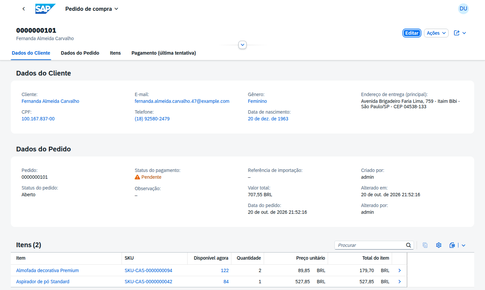 |
| **Pagamento aprovado** | **Finalizado** |
| 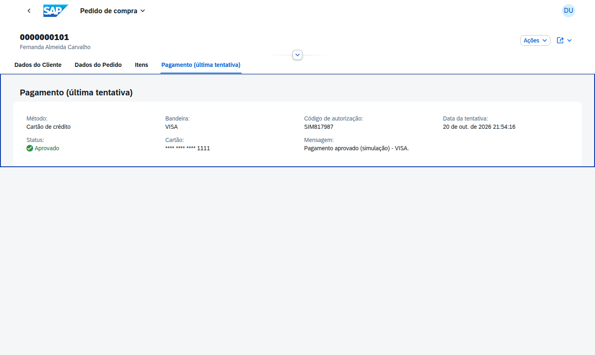 | 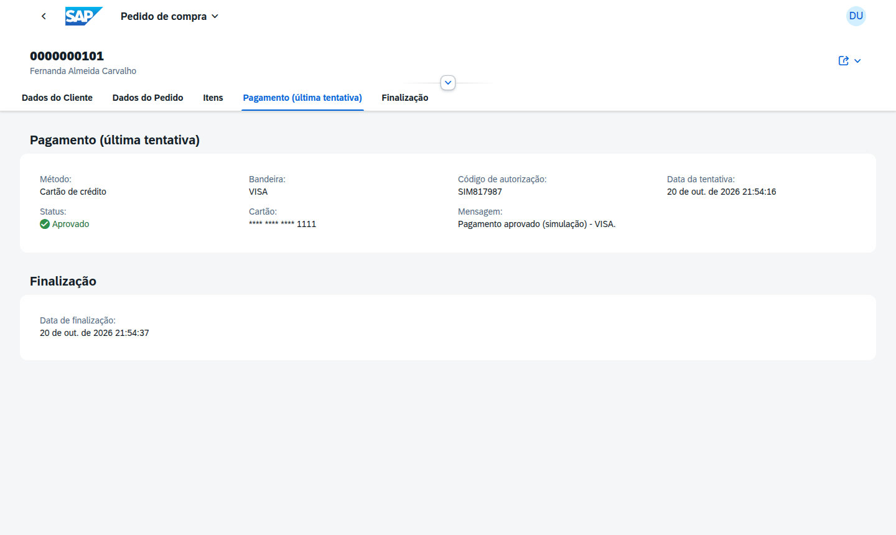 |

---

## 6. Regras de Negócio

### 6.1 Clientes e endereços

- O cliente nasce ativo, com score sorteado; CPF e telefone gravados só com dígitos.
- No Save, o CPF precisa ter dígitos verificadores válidos e ser único.
- Exclusão bloqueada se houver pedido do cliente, gravado ou em rascunho (`CLIENTE_COM_PEDIDO`).
- O primeiro endereço vira principal; *Definir como principal* desmarca os demais.
- Ao informar o CEP, o backend preenche logradouro, bairro, cidade e UF: reaproveita um CEP já
  validado ou consulta o ViaCEP (timeout de 5 s, cache por processo).
- CEP inexistente (`I`) ou ViaCEP indisponível (`X`) bloqueia o Save. **CEP geral** (município sem
  logradouro) torna logradouro e bairro editáveis e obrigatórios.
- O mesmo CEP não se repete no mesmo cliente; número obrigatório.


| Rascunho do cliente | Endereço preenchido pelo CEP | Cliente criado |
| :---: | :---: | :---: |
| 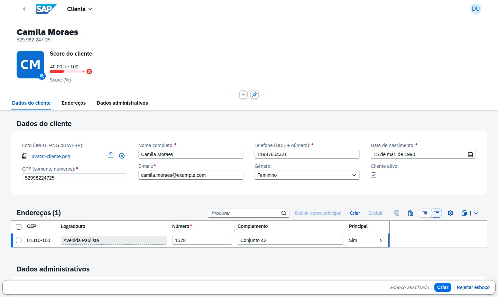 |  | 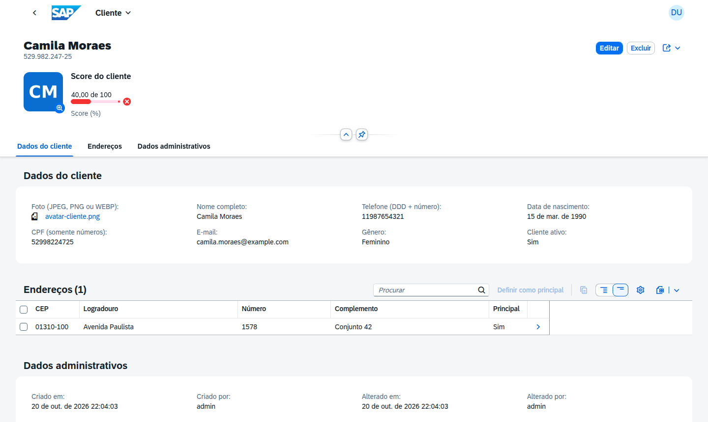 |

### 6.2 Itens e estoque

- O item nasce ativo, em BRL, com estoque e reserva 0.
- **SKU** `SKU-<3 letras da categoria>-<10 dígitos>` (ex.: `SKU-ELE-0000000042`), gerado no Save e
  regenerado se a categoria mudar de prefixo.
- `qtdeReservada` só é alterada pelos pedidos; o Save do item preserva reservas feitas durante a edição.
- Inativação bloqueada com estoque disponível ou pedido ativo; exclusão bloqueada com reserva ou pedido.

| Novo item | Item criado com SKU |
| :---: | :---: |
| 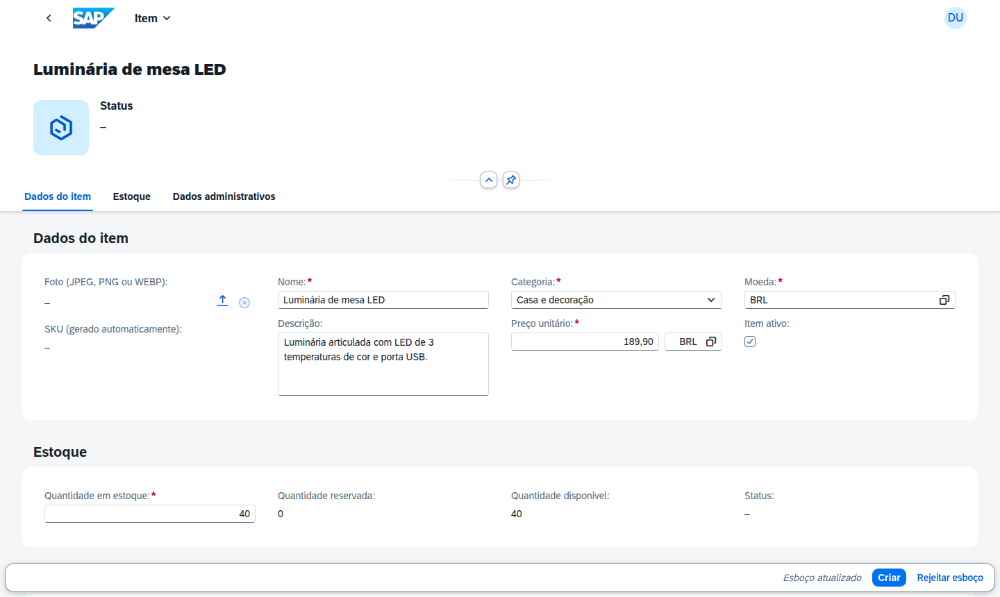 | 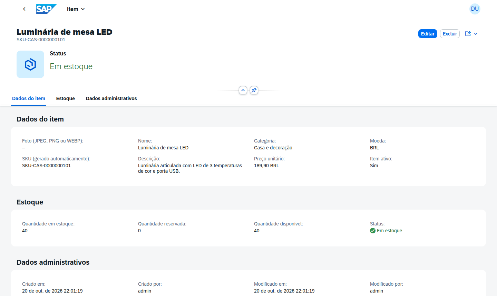 |

### 6.3 Registro e edição do pedido

- No rascunho, ao escolher o cliente o endereço principal é preenchido; ao escolher item ou
  quantidade, preço e totais são recalculados. O rascunho **não** reserva estoque e barra itens sem
  disponível (`ITEM_SEM_ESTOQUE`).
- O primeiro **Salvar** valida cliente ativo com endereço principal, ao menos um item ativo,
  quantidade `> 0` e disponível suficiente; então fixa preços, gera o número e reserva o estoque.
  Qualquer erro desfaz tudo.
- Na edição (só em `ABERTO`), o cliente é imutável e a reserva é ajustada pela diferença.


### 6.4 Pagamento simulado

- Só em `ABERTO` (inclusive após recusa). Os dados do cartão existem apenas em memória.
- Dados inválidos (número fora de 13–19 dígitos, validade fora de `MM/AA` ou expirada, CVV sem 3–4
  dígitos) são erro de entrada (HTTP 400, `CARTAO_DADOS_INVALIDOS`), não recusa.
- Bandeira pelo primeiro dígito (4 → `VISA`, 5 → `MASTERCARD`, demais → `OUTRA`).
- CVV `000` → `RECUSADO` (pedido segue `ABERTO`); demais → `APROVADO` com código `SIMnnnnnn`.
- Só a última tentativa é mantida em `Pagamentos`.
- O diálogo é uma ação customizada (`webapp/ext/EfetuarPagamento.js`) com `sap.m.MaskInput` no
  cartão (`9999 9999 9999 9999`), validade (`99/99`) e CVV; o botão só habilita com tudo preenchido.


*Diálogo Efetuar Pagamento com máscara no cartão, na validade e no CVV.*

### 6.5 Aprovação

Só em `AGUARDANDO_APROVACAO` com pagamento `APROVADO`. Baixa estoque e reserva, gera os snapshots
(`FINALIZACAO`), preenche `dataFinalizacao` e muda para `FINALIZADO`.


### 6.6 Cancelamento e reembolso

- Cancelamento permitido em `ABERTO` e `AGUARDANDO_APROVACAO`, com motivo obrigatório.
- **Sem pagamento aprovado:** libera a reserva, gera snapshots (`CANCELAMENTO`) e cancela.
- **Com pagamento aprovado:** cria o reembolso `PENDENTE` e o pedido vai para
  `PROCESSANDO_REEMBOLSO`, mantendo a reserva.
- **Aprovar reembolso** (motivo opcional): cancela o pedido, libera a reserva, gera snapshots e
  marca o pagamento como `DEVOLVIDO`.
- **Rejeitar reembolso** (motivo obrigatório): o pedido volta ao status anterior.
- Cada solicitação é decidida uma única vez (`REEMBOLSO_STATUS_INVALIDO`).


| Motivo do cancelamento | Pedido pago enviado para reembolso |
| :---: | :---: |
| 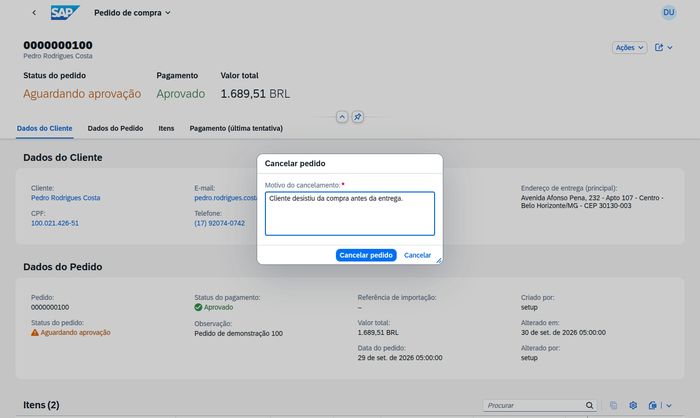 | 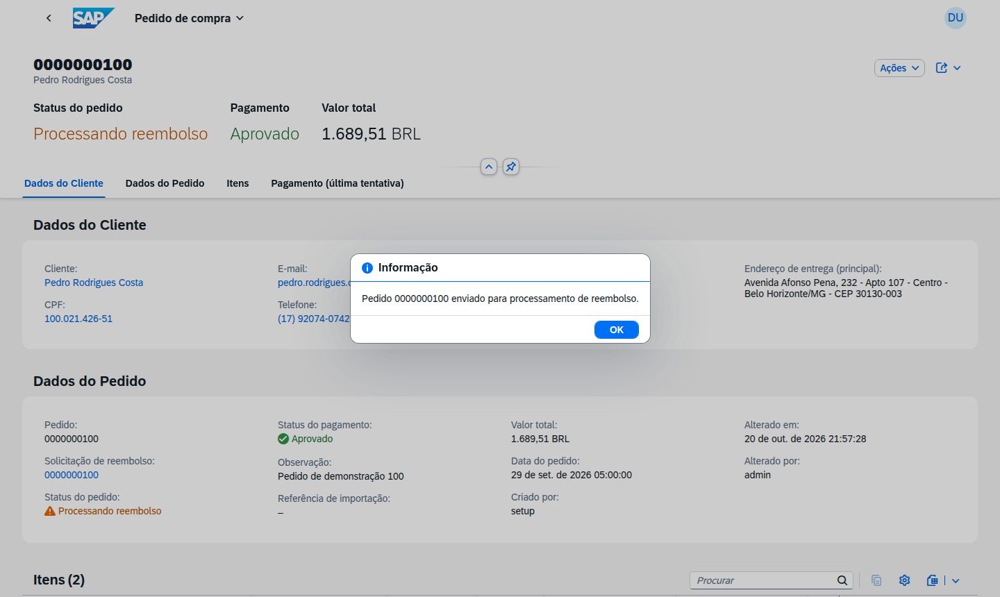 |
| **Pedido em processamento de reembolso** | **Pedido aberto cancelado** |
| 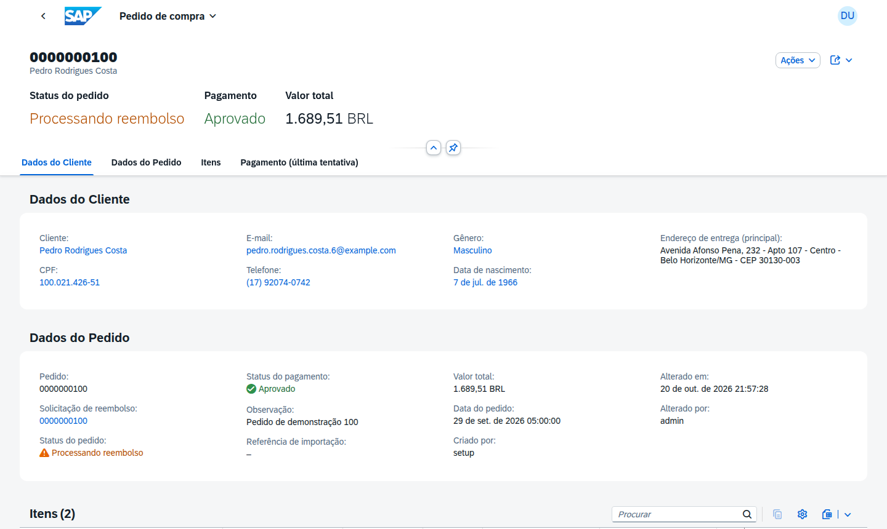 | 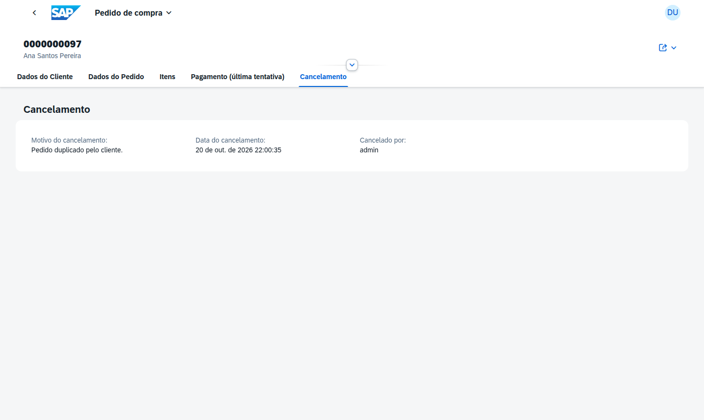 |
| **Solicitação pendente** | **Aprovar reembolso** |
| 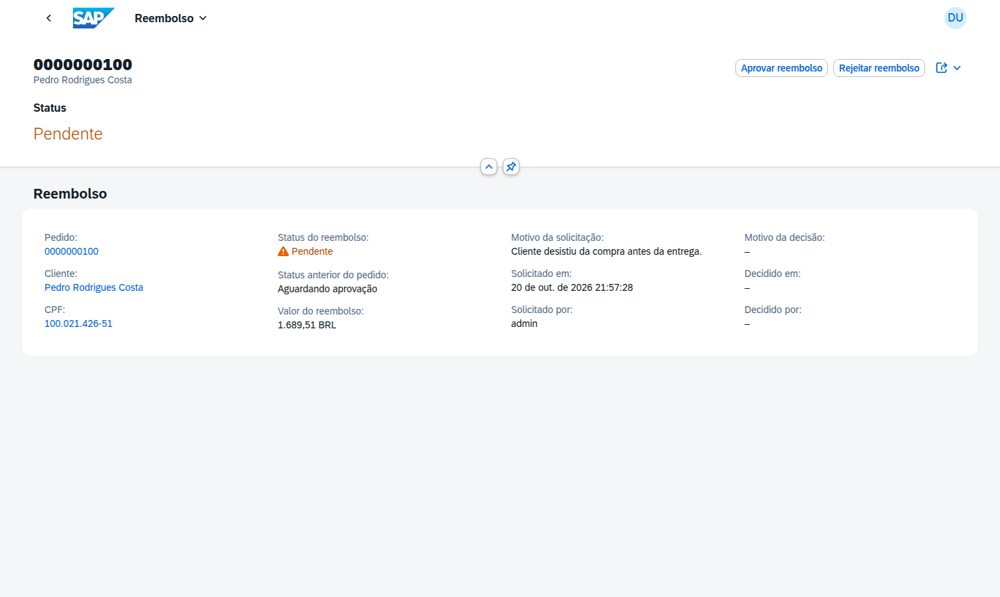 |  |
| **Reembolso aprovado** | **Pedido cancelado e pagamento devolvido** |
| 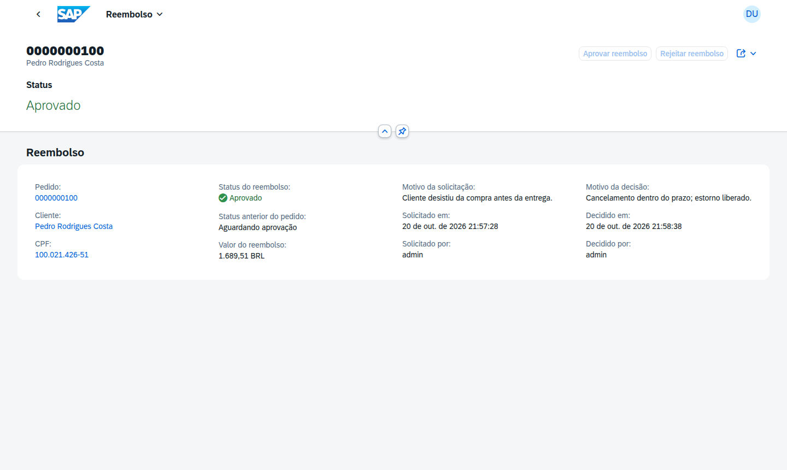 | 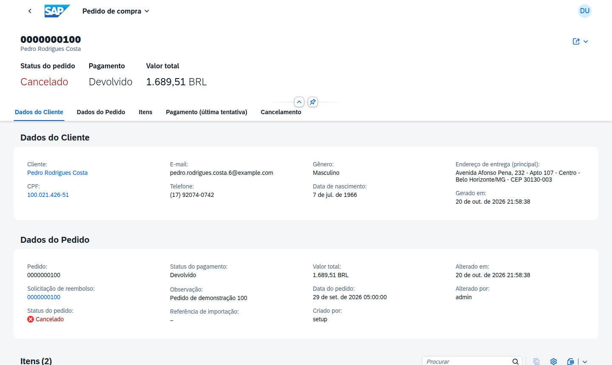 |
| **Rejeitar com motivo** | **Reembolso rejeitado** |
| 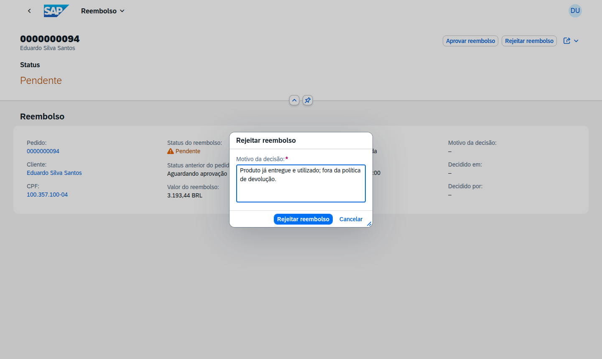 | 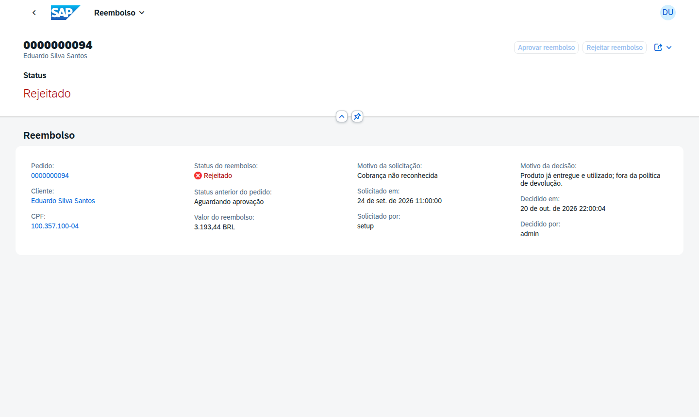 |

### 6.7 Snapshots

Criados uma única vez, na aprovação ou no cancelamento. Na Object Page do pedido encerrado, as
seções Dados do Cliente e Itens passam a mostrar os snapshots, então mudanças posteriores no
cadastro não alteram o histórico.

---

## 7. Estoque e Concorrência

| Movimento | Quando | Efeito | Condição no banco |
|---|---|---|---|
| Reservar | Registro; acréscimo na edição | `qtdeReservada += q` | item ativo e disponível `>= q` |
| Liberar | Redução na edição; cancelamento; reembolso aprovado | `qtdeReservada -= q` | `qtdeReservada >= q` |
| Baixar | Aprovação | `qtdeReservada -= q`, `qtdeEstoque -= q` | reserva e estoque `>= q` |

- Cada movimento é um único `UPDATE ... WHERE ID = ? AND <condição>` sobre o saldo atual do banco.
  Se outra transação consumiu o saldo, nenhuma linha muda e o pedido recebe um erro
  (`ITEM_ESTOQUE_INSUFICIENTE`, `ITEM_ESTOQUE_CONCORRENTE`...).
- Toda ação do pedido começa por `transicionarPedido`, um `UPDATE` condicionado ao status lido.
  Entre duas ações simultâneas, só a primeira é aplicada; a outra recebe
  `PEDIDO_ALTERADO_CONCORRENTE` (HTTP 409) antes de tocar no estoque.
- Como a requisição roda numa transação, qualquer erro desfaz movimentos, número e snapshots.

---

## 8. Importação por Planilha

Botão **Importar planilha** nas listas de Clientes, Estoque e Pedidos.

- `.xlsx` ou `.csv` (separador `;`, `,` ou tabulação); até 500 linhas; nomes de coluna comparados
  sem acento, espaço ou caixa.
- **Tudo ou nada:** todas as linhas são validadas antes de gravar; com qualquer erro nada é gravado
  e os erros são listados por linha.
- A gravação passa pelo próprio serviço, com as mesmas regras da tela.
- Modelos em [`modelos-importacao`](modelos-importacao).

| Planilha | Colunas obrigatórias | Observações |
|---|---|---|
| Clientes (`Admin`) | CPF, Nome, E-mail, Telefone, Data de nascimento, CEP, Número | Um cliente por linha, com o endereço principal |
| Estoque (`Admin`) | Nome, Categoria, Quantidade em estoque, Preço unitário | Nome já cadastrado é recusado, sem diferenciar maiúsculas |
| Pedidos | Pedido (referência), CPF, SKU, Quantidade | Linhas com a mesma referência formam um pedido; reenviar a planilha não duplica pedidos |


| Escolha da planilha | Importação concluída | Recusa por nome duplicado |
| :---: | :---: | :---: |
| 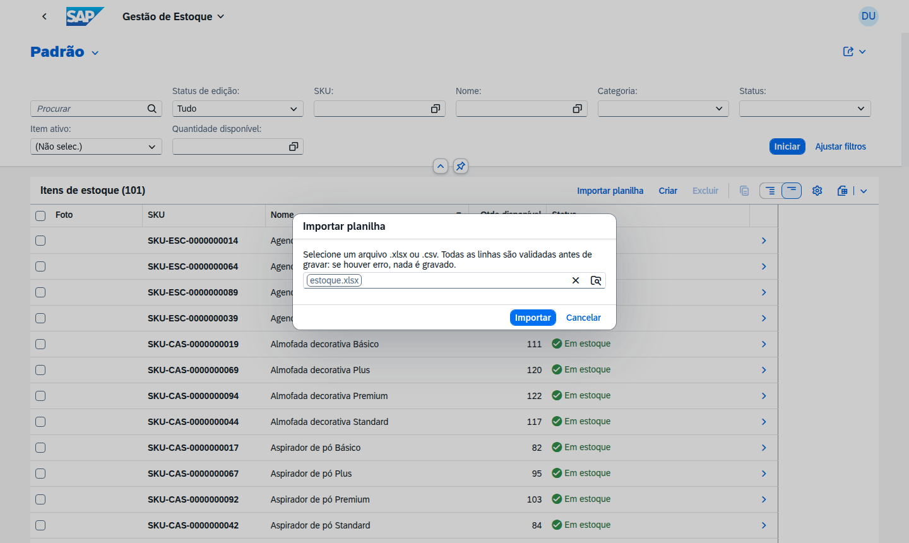 |  | 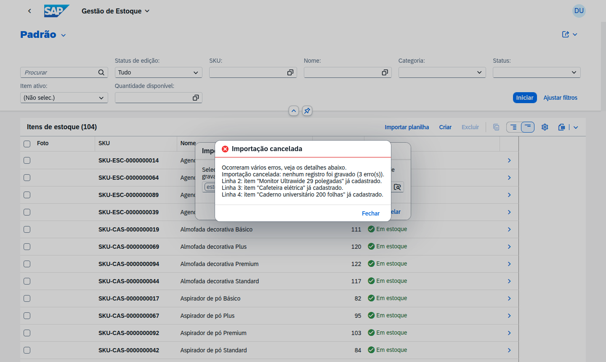 |

---

## 9. Análises

`AnaliticoService` expõe quatro visões somente leitura, consultadas com
`$apply=groupby((dimensão),aggregate(medida))`. Cada domínio tem uma app freestyle com barra de
filtros, indicadores, 5 gráficos, página de detalhe por análise e o botão **Abrir gestão**.

| App | Indicadores | Análises |
|---|---|---|
| Análise de Pedidos de Compras | Valor total, pedidos, ticket médio | Valor por status, quantidade por mês, valor por UF, status de pagamento, ticket médio |
| Análise de Clientes | Clientes, score médio | Por gênero, por UF, por faixa de score, cadastros por mês, score médio por UF |
| Análise de Itens do Estoque | Itens, estoque, reservada, disponível, valor | Reservado × disponível, situação, valor por categoria, 10 mais reservados, itens por categoria |
| Análise de Pedidos de Reembolsos | Reembolsos, valor | Valor e quantidade por status, valor por mês, valor por UF, quantidade por motivo |

| Pedidos | Clientes |
| :---: | :---: |
|  |  |
| **Estoque** | **Reembolsos** |
|  |  |
| **Filtro por status** | **Detalhe de uma análise** |
| 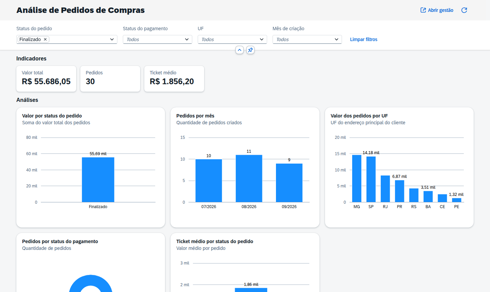 |  |

---

## 10. Interface do Usuário

| Aplicação | Tipo | Caminho |
|---|---|---|
| Gestão de Clientes | Fiori Elements V4 | `/gestaoclientes/index.html` |
| Gestão de Estoque | Fiori Elements V4 | `/gestaoestoque/index.html` |
| Pedidos de Compras | Fiori Elements V4 | `/pedidoscompras/index.html` |
| Gestão de Reembolsos | Fiori Elements V4 | `/gestaoreembolsos/index.html` |
| Análises (4 apps) | SAPUI5 freestyle | `/analisepedidos`, `/analiseclientes`, `/analiseestoque`, `/analisereembolsos` |
| Launchpad local | Sandbox do SAP Fiori launchpad | `/launchpad.html` |

| Gestão de Clientes | Gestão de Estoque |
| :---: | :---: |
|  |  |
| **Pedidos de Compras** | **Gestão de Reembolsos** |
|  |  |

**Object Page do pedido.** Cabeçalho com status e total; menu *Ações* (Efetuar Pagamento, Aprovar,
Cancelar) habilitado conforme o status; seções Dados do Cliente, Dados do Pedido, Itens, Pagamento,
Finalização e Cancelamento. O usuário informa só o cliente (na criação) e os itens.


**Navegação entre apps.** Cliente/CPF, Item/SKU, Pedido e Solicitação de reembolso viram links que
abrem o registro na app de destino (intents `Cliente-manage`, `ItemEstoque-manage`,
`PedidoCompra-manage`, `Reembolso-manage`). As análises navegam pela ação *Abrir gestão*.

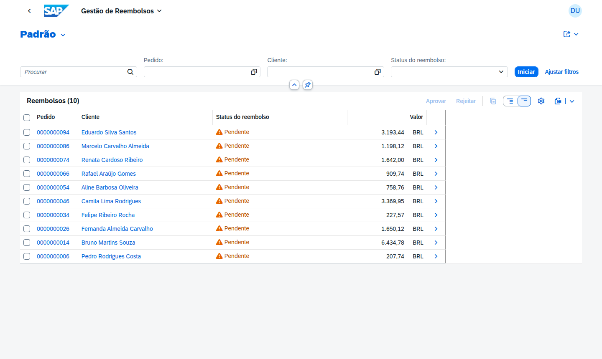

*Gestão de Reembolsos aberta pelo botão Abrir gestão da análise de reembolsos.*

**Mensagens.** Todas as mensagens de negócio estão em `_i18n/messages.properties`, com chaves por
domínio (`CLIENTE_*`, `CEP_*`, `ITEM_*`, `PEDIDO_*`, `PAGAMENTO_*`, `REEMBOLSO_*`, `IMPORTACAO_*`).

---

## 11. JavaScript × TypeScript

| Aspecto | `nodejs-padrao` | `nodejs-typescript` |
|---|---|---|
| Handlers | JavaScript ESM | TypeScript 6.0 `strict` |
| Entidades e consultas | `cds.entities`, `cds.ql` | Classes do cds-typer (`#cds-models/...`), consultas tipadas |
| Execução | `cds watch` | `cds-tsx watch` |
| Build | `cds build` copia os `.js` | `cds build` compila com `tsc` |
| Modelo CDS, apps, dados e i18n | Idênticos | Idênticos |

Regra de manutenção: toda mudança de regra de negócio é feita nas duas versões, com teste nas duas
suítes.

| Comando | Ação |
|---|---|
| `npm install` | Instala as dependências |
| `npm run watch` | Executa (cria o `db.sqlite` na primeira vez) |
| `npm run db:deploy` | Recria o banco local |
| `npm test` | Executa os testes |
| `npm run lint` | Lint (no TypeScript, inclui verificação de tipos) |
| `npm run dados:demo` | Regenera os dados de demonstração |

---

## 12. Testes e Critérios de Aceite

Testes `node:test` + `@cap-js/cds-test` em SQLite em memória, com ViaCEP falso local: 74 em
JavaScript e 76 em TypeScript. As apps de análise têm testes QUnit em
`/<app>/test/testsuite.qunit.html`.

| Arquivo | Critérios cobertos |
|---|---|
| `unidade.test` | CPF, e-mail, telefone, imagens, SKU, status de estoque, pagamento simulado, leitor XLSX/CSV |
| `clientes.test` | ViaCEP e reaproveitamento de CEP, CEP geral, endereço principal, CPF, permissões, exclusão, foto |
| `estoque.test` | SKU, status, reserva preservada na edição, inativação, exclusão, permissões, foto |
| `pedidos.test` | Registro com reserva, edição pela diferença, pagamento, aprovação, cancelamento, ações simultâneas, campos somente leitura |
| `reembolsos.test` | Aprovar, rejeitar com motivo, decisão única |
| `importacao.test` | Tudo ou nada, duplicidades recusadas, modelos de `docs/` |
| `analitico.test` | Agregações `$apply` dos quatro domínios |

---

## 13. Estrutura de Cada Implementação

```text
├── _i18n/messages.properties   mensagens de negócio
├── app/                        apps, launchpad e anotações
├── db/                         common.cds, schema.cds e data/ (CSV)
├── srv/                        serviços, handlers, validações e lib/
├── scripts/                    gerador de dados e preparação do SQLite
├── test/                       testes automatizados
└── package.json
```

---

## 14. Implantação na SAP BTP (pendente)


*SAP Build Work Zone e HTML5 Application Repository, serviço CAP e db-deployer no Cloud Foundry, HDI
container no SAP HANA Cloud e XSUAA.*

- SAP HANA Cloud: `@cap-js/hana` e o perfil `[production]` já configurados; falta implantar.
- XSUAA (`xs-security.json` com `Admin` e `Comum`) e *role collections*.
- `mta.yaml` (`cds add xsuaa,html5-repo,workzone,mta`), `mbt build` e `cf deploy`.
- Apps no SAP Build Work Zone.

**Evoluções futuras:** histórico de tentativas de pagamento, auditoria e logs estruturados,
monitoramento, armazenamento externo de imagens, gateway de pagamento e frete reais, estoque mínimo
por item.

---

## 15. Histórico de Revisões

| Versão | Principais mudanças |
|---|---|
| 2.0 | Sistema implementado: novos status do pedido, registro no Salvar, reembolsos, importação, análises, 8 apps e testes |
| 2.1 | Campos somente leitura no pedido, navegação entre apps, importação de pedidos sem duplicidade |
| 2.2 | Quatro apps de análise, máscara no pagamento, navegações das Object Pages |
| 2.3 | Permissões na UI, ações recusadas no rascunho (HTTP 409), limites na importação |
| 2.4 | Transições de status atômicas nas ações do pedido |
| 2.5 | Fotos gravadas corretamente, SQLite em arquivo e SAP HANA Cloud configurado |
| 2.6 | Especificação simplificada, com diagramas e capturas de tela |
