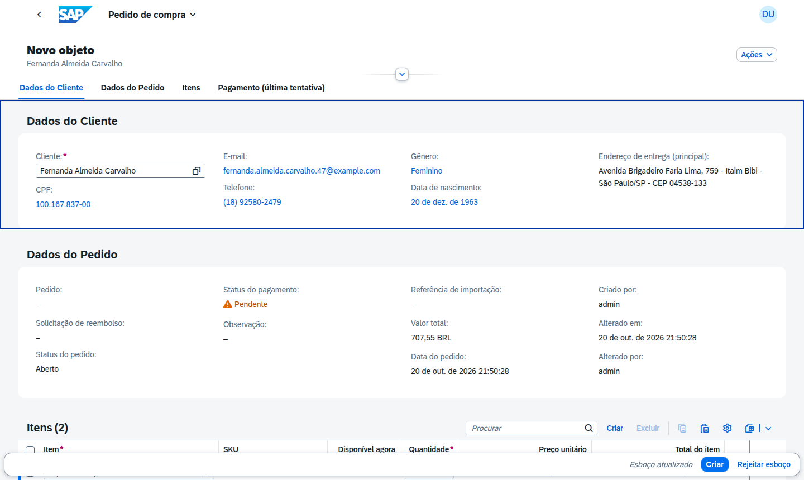
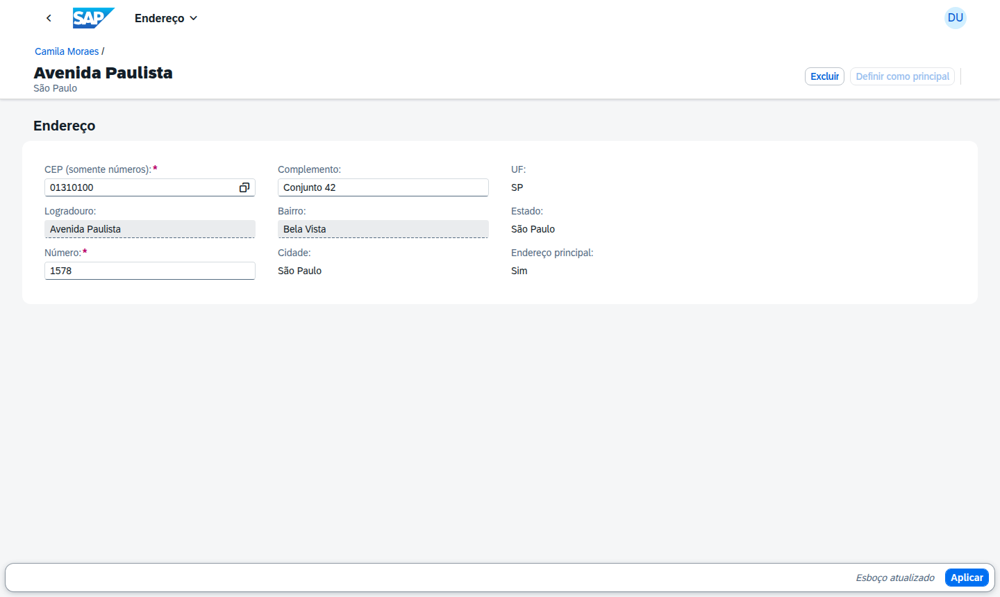
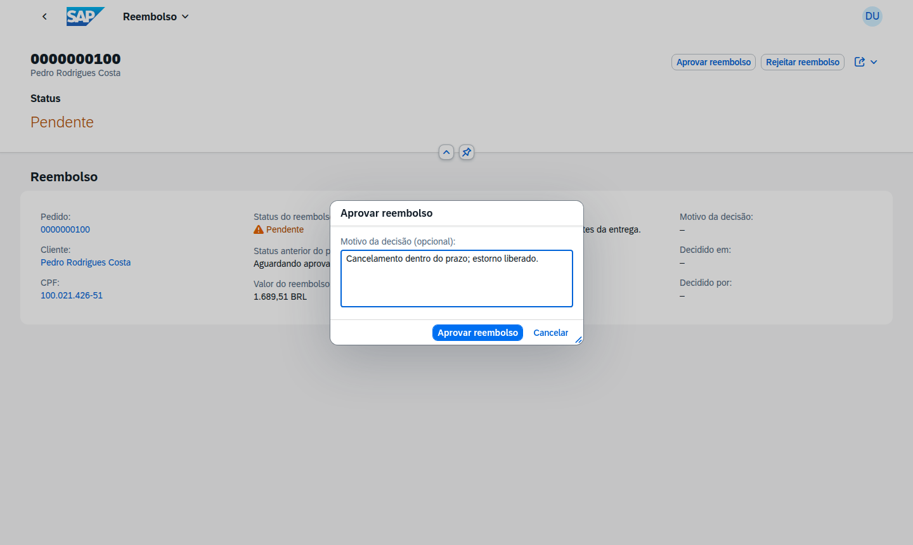
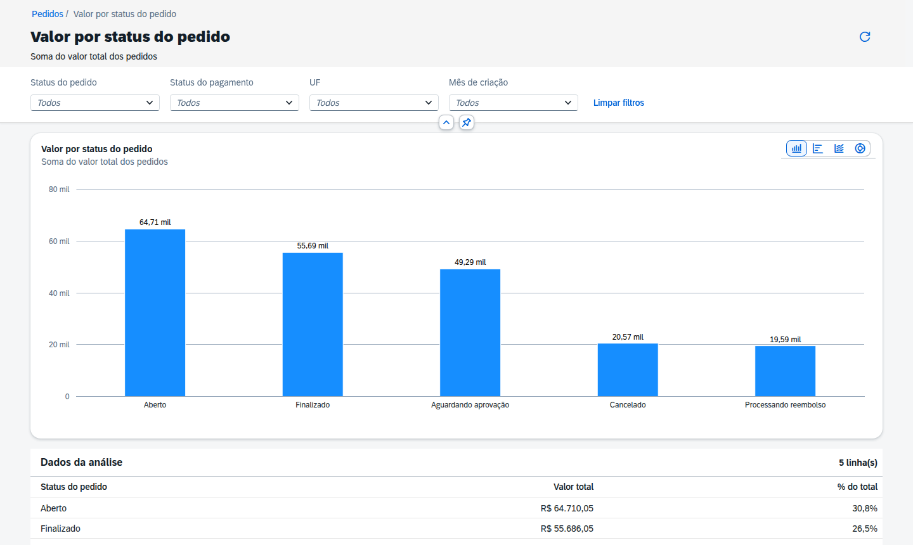

# Front-end Fiori – Pedidos de Compras

Oito aplicações **SAPUI5** servidas pelo próprio CAP, sobre os serviços OData V4 do projeto:

- quatro de **gestão**, em **SAP Fiori Elements** (List Report + Object Page), geradas com o **SAP
  Fiori tools** (template *List Report Page V4*, serviço *Local CAP*);
- quatro de **análise**, em **SAPUI5 freestyle**, uma por domínio (veja
  [Apps de análise](#apps-de-análise-freestyle));
- um **launchpad local** (`launchpad.html`) que reúne as oito apps (veja
  [Launchpad local](#launchpad-local)).

As apps são *workspaces* npm da implementação (`"workspaces": ["app/*"]`): um único `npm install`
na raiz instala tudo, e o `cds-plugin-ui5` serve cada app em `/<sap.app.id>/`, sem build. O conteúdo
desta pasta é idêntico em [`nodejs-padrao/app`](../../nodejs-padrao/app) e
[`nodejs-typescript/app`](../../nodejs-typescript/app).

A UI das apps de gestão é orientada a anotações: colunas, filtros, seções, ações, criticidade e side
effects vêm de `<app>/annotations.cds` e de `common.cds` (rótulos e textos comuns). O
[`services.cds`](services.cds) reúne as anotações das quatro apps no modelo do CAP.

| App | Pasta | `sap.app.id` | Serviço (OData V4) | Tile (inbound) |
| --- | --- | --- | --- | --- |
| [Gestão de Clientes](gestao-clientes/README.md) | `gestao-clientes/` | `gestaoclientes` | `ClientesService` (`/odata/v4/clientes`) | `Cliente-manage` |
| [Gestão de Estoque](gestao-estoque/README.md) | `gestao-estoque/` | `gestaoestoque` | `EstoqueService` (`/odata/v4/estoque`) | `ItemEstoque-manage` |
| [Pedidos de Compras](pedidos-compras/README.md) | `pedidos-compras/` | `pedidoscompras` | `PedidosService` (`/odata/v4/pedidos`) | `PedidoCompra-manage` |
| [Gestão de Reembolsos](gestao-reembolsos/README.md) | `gestao-reembolsos/` | `gestaoreembolsos` | `ReembolsosService` (`/odata/v4/reembolsos`) | `Reembolso-manage` |
| [Análise de Pedidos de Compras](analise-pedidos/README.md) | `analise-pedidos/` | `analisepedidos` | `AnaliticoService` (`/odata/v4/analitico`) | `AnalisePedidos-display` |
| [Análise de Clientes](analise-clientes/README.md) | `analise-clientes/` | `analiseclientes` | `AnaliticoService` | `AnaliseClientes-display` |
| [Análise de Itens do Estoque](analise-estoque/README.md) | `analise-estoque/` | `analiseestoque` | `AnaliticoService` | `AnaliseEstoque-display` |
| [Análise de Pedidos de Reembolsos](analise-reembolsos/README.md) | `analise-reembolsos/` | `analisereembolsos` | `AnaliticoService` | `AnaliseReembolsos-display` |

<p align="center">
  
</p>

## Estrutura de cada app

```text
<app>/                    app Fiori Elements
├── annotations.cds       anotações de UI: colunas, filtros, seções, ações, side effects
├── package.json          workspace npm (ferramentas UI5 e ESLint)
├── ui5.yaml              UI5 da CDN e preview do Fiori tools
├── eslint.config.mjs     regras do @sap-ux/eslint-plugin-fiori-tools
└── webapp/
    ├── manifest.json     descriptor 2.0.0: serviço, rotas LR → OP → sub-OP, tabelas, ações, tile
    ├── Component.js      sap/fe/core/AppComponent
    ├── ext/              código das ações customizadas (Importar planilha, Efetuar Pagamento)
    ├── i18n/             textos pt-BR
    └── test/integration/ testes OPA5 gerados pelo Fiori tools
```

```text
launchpad.html            sandbox do SAP Fiori launchpad (bootstrap do sap.ushell e do SAPUI5)
launchpad/
├── config.js             tiles e targets (intent → /<sap.app.id>)
└── init.js               cria o shell (renderer fiori2)
common.cds                rótulos, textos de CodeList e campos somente leitura comuns às apps
services.cds              reúne as anotações das apps de gestão
```

## Páginas

| App | List Report | Object Page | Sub-páginas |
| --- | --- | --- | --- |
| Clientes | `Clientes`, com *Importar planilha* | Cliente: *Dados do cliente*, *Endereços* e *Dados administrativos* | `Enderecos`, com a ação *Definir como principal* |
| Estoque | `Itens`, com *Importar planilha* | Item: *Dados do item*, *Estoque* e *Dados administrativos* | — |
| Pedidos | `Pedidos`, com *Importar planilha* e o menu *Ações* (Efetuar Pagamento, Aprovar, Cancelar) | Pedido: *Dados do Cliente*, *Dados do Pedido*, *Itens*, *Pagamento* e, conforme o status, *Finalização* ou *Cancelamento* | `itens` (item do pedido) e `itensSnapshot` (item no encerramento) |
| Reembolsos | `Reembolsos`, com *Aprovar* e *Rejeitar* (sem criar, editar ou excluir) | Reembolso | — |

### Recursos da interface

- **Rascunho (draft)** em Clientes, Estoque e Pedidos: *Criar* e *Editar* abrem um rascunho; o
  *Salvar* valida e grava (no pedido, registra e reserva o estoque).
- **Pedido simples de preencher**: só o *Cliente* (na criação) e os itens são editáveis; os itens são
  criados na própria tabela (*inline*), só no rascunho, e o pedido não oferece *Excluir*.
- **Object Page dinâmica do pedido**: as seções aparecem conforme o status (`UI.Hidden`); em pedidos
  `FINALIZADO` ou `CANCELADO`, cliente e itens vêm dos **snapshots**.
- **Efetuar Pagamento** com diálogo próprio (`ext/EfetuarPagamento.js`) e máscara de digitação
  (`sap.m.MaskInput`) no cartão, na validade e no CVV, porque o diálogo padrão de parâmetros do Fiori
  Elements não tem máscara. O backend continua validando tudo.
- **Endereço pelo CEP**: o CEP é um campo padrão, com value help dos CEPs já cadastrados; o side
  effect `Common.SideEffects#Cep` recarrega logradouro, bairro, cidade e UF preenchidos pelo backend.
- **Importar planilha** (`ext/ImportarPlanilha.js`): diálogo de escolha de arquivo `.xlsx` ou `.csv`
  que chama a action `importarPlanilha` do serviço.
- **Perfil só de consulta**: o singleton `Permissoes` do serviço esconde *Criar*, *Editar*,
  *Excluir*, *Importar planilha* e *Definir como principal* em Clientes e Estoque.
- **Score do cliente** em %, numa barra vermelha (até 40), amarela (até 70) ou verde.

| Tela | Captura |
| --- | --- |
| Rascunho do pedido com itens *inline* |  |
| Efetuar Pagamento com máscara |  |
| Endereço preenchido pelo CEP |  |
| Decisão de reembolso |  |

### Navegação entre apps

No launchpad local, os campos abaixo viram links que abrem a Object Page do registro na app de
destino. A app de destino localiza o registro pela chave semântica (`cpf`, `sku`, `numeroPedido`)
recebida no contexto da navegação.

| Origem | Campos com link | Destino |
| --- | --- | --- |
| Pedidos | Cliente, CPF | Gestão de Clientes (`Cliente-manage`, `cpfCliente` → `cpf`) |
| Itens do pedido | Item, SKU | Gestão de Estoque (`ItemEstoque-manage`, `skuItem` → `sku`) |
| Pedidos | *Solicitação de reembolso* (link direto, só quando o pedido tem reembolso) | Gestão de Reembolsos (`Reembolso-manage`, `numeroPedido`) |
| Pedidos (encerrado) | Cliente, CPF do snapshot | Gestão de Clientes |
| Item no encerramento | Item, SKU do snapshot | Gestão de Estoque |
| Reembolsos | Pedido (link direto) | Pedidos de Compras (`PedidoCompra-manage`) |
| Reembolsos | Cliente, CPF | Gestão de Clientes |
| Apps de análise | Botão *Abrir gestão* | App de gestão do domínio |

O launchpad liga a resolução de intents no cliente (`ClientSideTargetResolution`); sem ela o Fiori
Elements não recebe os objetos semânticos disponíveis e esconde os links.

## Apps de análise (freestyle)

Quatro apps **SAPUI5 freestyle** (OData V4, somente leitura), um por domínio. Todos leem o
**`AnaliticoService`**, cujas entidades têm `@Aggregation.default` nas medidas (no OData, *custom
aggregates*), o que permite `$apply=groupby/aggregate` no servidor. Cada app usa só a entidade do seu
domínio.

| App | Pasta | Entidade | KPIs | Abrir gestão |
| --- | --- | --- | --- | --- |
| Análise de Pedidos de Compras | `analise-pedidos/` | `PedidosAnalise` | valor total, pedidos, ticket médio | `PedidoCompra-manage` |
| Análise de Clientes | `analise-clientes/` | `ClientesAnalise` | clientes, score médio | `Cliente-manage` |
| Análise de Itens do Estoque | `analise-estoque/` | `ItensAnalise` | itens, em estoque, reservada, disponível, valor em estoque | `ItemEstoque-manage` |
| Análise de Pedidos de Reembolsos | `analise-reembolsos/` | `ReembolsosAnalise` | reembolsos, valor dos reembolsos | `Reembolso-manage` |

- **Painel** (`#/`): barra de filtros, indicadores (KPIs) e os 5 gráficos do domínio.
- **Detalhe** (`#/analise/<cenário>`, clicando no título do card): gráfico ampliado com troca do tipo
  e tabela com os valores e o % do total.
- Os **filtros** valem para os KPIs e para todos os gráficos, e continuam aplicados ao abrir um
  detalhe e ao voltar. As opções vêm do próprio serviço (`groupby` do campo).
- **Abrir gestão** abre a app de gestão do domínio: navegação por intent no launchpad; fora dele, a
  app vizinha (`../<sap.app.id>/index.html`) em outra aba.

Filtros e cenários de cada app estão no README dela.

| Painel | Detalhe |
| --- | --- |
|  |  |

### Estrutura

Os quatro projetos têm a mesma estrutura e o mesmo motor; só mudam o catálogo
(`model/Scenarios.js`), os textos, os testes e o `manifest.json` (id e tile):

```text
analise-<domínio>/webapp/
├── Component.js                 estado compartilhado (filtros), serviço e roteamento
├── manifest.json                rotas "" / analise/{scenario}, modelo OData V4, tile
├── model/Scenarios.js           catálogo do domínio: entidade, filtros, KPIs e os 5 cenários
├── model/AnalyticsQuery.js      monta o $apply e molda as linhas; sem dependência de UI
├── model/formatter.js           formatação de valores, quantidades e meses
├── service/AnalyticsService.js  ODataListBinding + $$aggregation (filter/groupby/aggregate)
├── control/AnalysisChart.js     VizFrame (sap.viz) configurado por dimensão, medidas e tipo
├── control/FilterBar.js         filtros (lista, sim/não, texto)
├── controller/ view/            App, Dashboard e Detail
├── i18n/i18n.properties         textos pt-BR (cenários, medidas, dimensões)
└── test/                        suíte QUnit: catálogo e consultas
```

Para **incluir um cenário**, acrescente uma entrada em `model/Scenarios.js` da app e os textos
`<id>.title` / `<id>.sub` no `i18n.properties` (o teste do catálogo falha se faltar alguma chave).
Uma correção no motor (`AnalyticsQuery`, `AnalyticsService`, `control/`, `controller/`, `view/`)
deve ser repetida nos quatro apps: os arquivos são iguais, a menos do namespace.

> [!NOTE]
> As medidas usam a agregação padrão do backend, por isso o `$apply` é `aggregate(medida)` sem
> método. Se um gráfico vier vazio ou com erro, teste a URL direto no serviço, por exemplo
> `/odata/v4/analitico/ClientesAnalise?$apply=groupby((genero),aggregate(qtdeClientes))`.

## Executar localmente

Na raiz da implementação (`nodejs-padrao/` ou `nodejs-typescript/`):

```sh
npm install
npm run watch      # serviços + apps em http://localhost:4004
```

| Página | URL |
| --- | --- |
| Launchpad local | `http://localhost:4004/launchpad.html` |
| App isolada | `http://localhost:4004/<sap.app.id>/index.html` (ex.: `/pedidoscompras/index.html`) |
| Testes QUnit de uma análise | `http://localhost:4004/<sap.app.id>/test/testsuite.qunit.html` |

Usuários de desenvolvimento: `admin` / `admin` (tudo) e `comum` / `comum` (Clientes e Estoque só para
consulta). Os dados de demonstração e os cenários de teste estão no
[README da implementação](../README.md).

## Launchpad local

`launchpad.html` simula o SAP Fiori launchpad com o sandbox do `sap.ushell` (SAPUI5 1.148 da CDN). A
página inicial tem um tile por app, e cada tile abre a app pelo mesmo intent do inbound do manifest
dela, o que habilita a navegação entre apps (pedido → cliente / item / reembolso, *Abrir gestão* nas
análises).

- Os tiles e targets ficam em `launchpad/config.js` (`applications`, chave = intent, `url` =
  `/<sap.app.id>`).
- As apps são servidas direto do `webapp/` de cada projeto pelo `cds-plugin-ui5`: alterações nelas
  aparecem no launchpad ao recarregar a página.
- Para incluir uma app: crie a pasta em `app/` (vira um workspace), inclua-a em `sapux` no
  `package.json` da implementação, declare o inbound no `manifest.json` e acrescente o tile em
  `launchpad/config.js`.

## Validar

| Tipo | Onde | Como rodar |
| --- | --- | --- |
| QUnit | `analise-*/webapp/test/unit/` (catálogo e consultas `$apply`) | `npm run watch` e `/<sap.app.id>/test/testsuite.qunit.html` |
| OPA5 (gerados pelo Fiori tools) | `<app>/webapp/test/integration/` | Journeys gerados; o projeto não inclui a página que os executa |
| UI5 linter | cada app | `npx @ui5/linter` na pasta da app |
| ESLint | cada app (`eslint.config.mjs`) | `npx eslint .` na pasta da app |

As regras de negócio que a UI exibe são cobertas pelos testes automatizados do backend
(`npm test` na raiz da implementação).

## Implantação

A publicação das apps na SAP BTP (HTML5 Application Repository + SAP Build Work Zone) ainda está
pendente. Cada app tem o script `deploy-config`, que gera a configuração de deploy para o Cloud
Foundry com o Fiori tools; a arquitetura alvo está no
[README principal](../../README.md#status-e-pendências).
