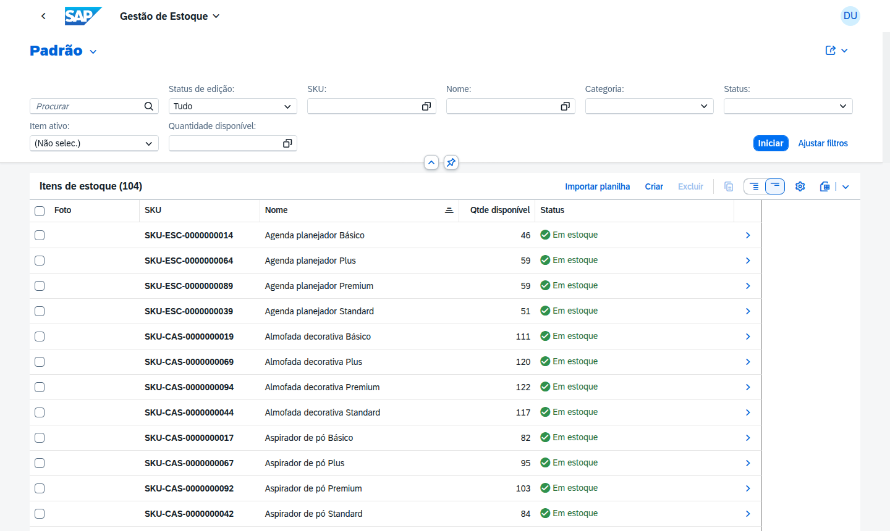

# Gestão de Estoque

App **SAP Fiori Elements** (OData V4, List Report + Object Page) para manter os itens de estoque e
acompanhar a disponibilidade.

| | |
| --- | --- |
| Serviço | `EstoqueService` (`/odata/v4/estoque`), entidade `Itens` |
| `sap.app.id` | `gestaoestoque` |
| Tile (inbound) | `ItemEstoque-manage` |
| URL local | `http://localhost:4004/gestaoestoque/index.html` |
| Perfis | `Admin` mantém; `Comum` só consulta |

## Páginas

- **Lista de itens**: foto, SKU, quantidades em estoque, reservada e disponível, status do estoque;
  filtros por SKU, nome, categoria, status, item ativo e quantidade disponível; ação **Importar
  planilha** (`webapp/ext/ImportarPlanilha.js`).
- **Item**: seções *Dados do item*, *Estoque* e *Dados administrativos*; o cabeçalho mostra a
  situação do estoque.

Regras que a tela reflete:

- o **SKU** (`SKU-<3 letras da categoria>-<10 dígitos>`) é gerado no *Salvar* e regenerado se a
  categoria muda;
- a quantidade disponível e o status do estoque são calculados pelo banco;
- a quantidade reservada só muda pelos pedidos, e a reserva feita por um pedido durante a edição do
  item é preservada no *Salvar*.

Para o perfil `Comum`, o singleton `Permissoes` esconde *Criar*, *Editar*, *Excluir* e *Importar
planilha*.

| Lista | Importação por planilha |
| :---: | :---: |
|  |  |

## Executar

Na raiz da implementação: `npm run watch` e abra a URL local acima, ou o tile no
`http://localhost:4004/launchpad.html`.

## Arquivos

| Arquivo | Conteúdo |
| --- | --- |
| `annotations.cds` | Colunas, filtros, seções, criticidade do estoque, side effect `#Estoque` |
| `webapp/manifest.json` | Rotas, tabela, ação *Importar planilha*, tile |
| `webapp/ext/ImportarPlanilha.js` | Diálogo de upload que chama a action `importarPlanilha` |
| `webapp/test/integration/` | Testes OPA5 gerados pelo Fiori tools |

Visão geral das apps: [`../README.md`](../README.md).

Dados da geração (SAP Fiori tools)

|               |
| ------------- |
|**Generation Date and Time** Thu Oct 08 2026 08:53:39 GMT-0300 (Horário Padrão de Brasília)|
|**App Generator** SAP Fiori Application Generator|
|**App Generator Version** 1.28.0|
|**Generation Platform** CLI|
|**Template Used** List Report Page V4|
|**Service Type** Local CAP|
|**Service URL** http://localhost:4004/odata/v4/estoque/|
|**Module Name** gestao-estoque|
|**Application Title** Gestão de Estoque|
|**Namespace** |
|**UI5 Theme** sap_horizon|
|**UI5 Version** 1.148.12|
|**Enable TypeScript** False|
|**Add Eslint configuration** True, see https://www.npmjs.com/package/@sap-ux/eslint-plugin-fiori-tools#rules for the eslint rules.|
|**Main Entity** Itens|

